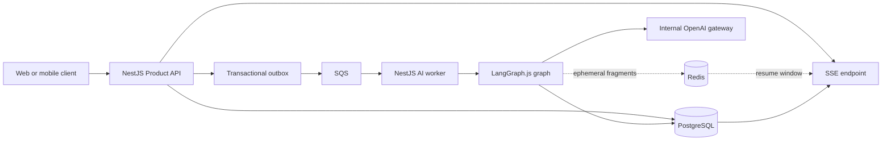

# Deutsch Mate AI Agent Architecture

**Status:** implementation baseline  
**Runtime:** TypeScript, NestJS workers, LangGraph.js  
**Authority order:** `docs/architecture.md`, `docs/MVP_SCOPE.md`, `docs/PRD.md`, `docs/Database.md`, `docs/API.md`, `docs/openapi.yaml`

## 1. Purpose and scope boundary

This document defines the durable AI workflow architecture. It is a design and contract document, not executable project code.

### 1.1 MVP graphs

Only these graphs are available in the first public paid release:

1. `text_tutor.v1` — streamed, curriculum-grounded text tutoring.
2. `writing_correction.v1` — asynchronous correction of a short writing activity.
3. `content_validation.v1` — internal validation evidence for human-controlled curriculum and AI releases.

The MVP does not use an LLM to place a learner, infer a formal level from chat, generate a readiness examination, score speaking, or issue a certificate. Deterministic lessons remain available when all AI graphs are disabled.

### 1.2 Post-MVP graphs

The following require separate product approval, API additions, reviewed database migrations, qualified reviewer operations, and their own release gates:

- `placement_form_generation.v1` and `placement_scoring.v1` for FR-011.
- `readiness_form_generation.v1` and `readiness_scoring.v1` for FR-051.
- `productive_response_scoring.v1` for writing and, only after FR-025, speaking.
- Psychometric calibration, item retirement, appeals, and the FR-073 reviewer console.

Placement and readiness outputs are estimates. They are not accredited CEFR certificates. CEFR C1/C2, official certification, remote proctoring, and named-provider equivalence are excluded.

## 2. Runtime topology and ownership



- `AiOrchestratorModule` owns graph admission, run records, graph registry, checkpoints, trace events, terminal disposition, and worker consumers.
- `AiGatewayModule` owns provider credentials, model invocation, structured output, budgets, safety controls, retries, and provider telemetry.
- `LearningModule` owns attempts, responses, scores, feedback, evidence, and learning-side terminal transactions.
- `ContentModule` owns immutable content versions, review events, publication validation, and published visibility.
- The API authenticates, authorizes, checks ownership and entitlement, claims idempotency, creates durable work, and returns. It never executes a provider call in the request transaction.
- Workers use `dm_ai_worker`, cannot bypass RLS, and may write only through owning services or explicitly granted inbox, `ai`, and terminal transaction procedures.
- Cross-process delivery is at least once. Effective business outcomes are once-only through `ops.inbox_events`, unique domain keys, and terminal transaction guards.

No graph node may directly mutate another capability's tables. Redis is never authoritative.

## 3. Graph registry and compilation

Graphs are compiled once per worker process from a closed registry. A request supplies a feature, never a graph module, node name, prompt, model, or tool list.

```ts
type MvpGraphId =
  | "text_tutor.v1"
  | "writing_correction.v1"
  | "content_validation.v1";

type PostMvpGraphId =
  | "placement_form_generation.v1"
  | "placement_scoring.v1"
  | "readiness_form_generation.v1"
  | "readiness_scoring.v1"
  | "productive_response_scoring.v1";

interface GraphDefinition<S, O> {
  readonly id: MvpGraphId | PostMvpGraphId;
  readonly stateSchemaVersion: number;
  readonly outputSchemaVersion: number;
  readonly maximumSteps: number;
  readonly allowedToolNames: readonly ToolName[];
  invoke(input: Readonly<S>, control: RunControl): Promise<O>;
}
```

Registry rules:

- Feature-to-graph routing is server configuration committed with the worker release.
- Startup fails if a graph references an unknown state reducer, output schema, tool, prompt key, or policy version.
- A run pins `graphId`, graph code release, state schema version, `ai.releases.id`, prompt/model versions, verifier version, and safety policy version before execution.
- An in-flight run never switches release after a deployment or rollback.
- A newer worker must read checkpoints from the current and immediately previous state schema. Incompatible changes use a new graph ID or a pure, tested checkpoint migration.
- Graphs are bounded DAGs or bounded loops. No node can create arbitrary subgraphs, dynamic tools, shell commands, code execution, or web access.

## 4. Common graph state

State is JSON-serializable, schema-validated at ingress and before every checkpoint. It contains IDs and bounded snapshots, never credentials, provider keys, OIDC tokens, signed URLs, database connections, callbacks, or unrestricted ORM entities.

```ts
type UUIDv7 = string;
type CefrLevel = "A1" | "A2" | "B1" | "B2";
type RunStatus =
  | "queued" | "running" | "succeeded" | "blocked"
  | "failed" | "timed_out" | "cancelled";
type Disposition = "released" | "blocked" | "safe_failure" | "internal_only";

interface CommonGraphState {
  readonly schemaVersion: number;
  readonly graphId: MvpGraphId | PostMvpGraphId;
  readonly runId: UUIDv7;
  readonly threadId: UUIDv7;
  readonly userId: UUIDv7;
  readonly correlationId: UUIDv7;
  readonly causationId?: UUIDv7;
  readonly release: PinnedAiRelease;
  readonly policy: PinnedPolicySet;
  readonly deadlineAt: string;
  readonly startedAt: string;
  readonly context: AssembledContext;
  readonly risk: RiskAssessment;
  readonly modelCalls: readonly ModelCallSummary[];
  readonly toolCalls: readonly ToolCallSummary[];
  readonly errors: readonly GraphError[];
  readonly stepCount: number;
  readonly cancellationRequested: boolean;
  readonly status: RunStatus;
  readonly disposition?: Disposition;
}

interface PinnedAiRelease {
  readonly releaseId: UUIDv7;
  readonly promptVersionId: UUIDv7;
  readonly modelConfigVersionId: UUIDv7;
  readonly verifierPromptVersionId?: UUIDv7;
  readonly graphCodeVersion: string;
  readonly outputSchemaId: string;
}

interface PinnedPolicySet {
  readonly safetyPolicyVersion: string;
  readonly piiPolicyVersion: string;
  readonly retentionPolicyVersion: string;
  readonly budgetPolicyVersion: string;
}
```

Reducers are explicit:

- Scalars are single-writer and replace-only.
- `modelCalls`, `toolCalls`, and `errors` append in deterministic sequence order.
- Context and release pins are immutable after the admission checkpoint.
- `stepCount` increments once per entered node and cannot exceed `maximumSteps`.
- Status follows `queued → running → terminal`; terminal states cannot transition.
- Only terminalization sets `disposition`.

Every state schema is represented by a strict runtime schema, with unknown fields rejected. The schema is exported as JSON Schema for checkpoint validation and test fixtures; TypeScript types are inferred from the same source.

## 5. Context assembly

Context assembly happens before model invocation and uses purpose-specific projections. It is not model-directed retrieval.

```ts
interface AssembledContext {
  readonly purpose: "tutor" | "writing" | "content_validation" | "assessment";
  readonly learner?: {
    readonly profileVersionId: UUIDv7;
    readonly selectedLevel: CefrLevel;
    readonly targetLevel?: CefrLevel;
    readonly goal: string;
    readonly interfaceLocale: string;
  };
  readonly curriculum?: {
    readonly curriculumReleaseId: UUIDv7;
    readonly unitVersionId: UUIDv7;
    readonly level: CefrLevel;
    readonly objectiveVersionIds: readonly UUIDv7[];
    readonly approvedExcerptIds: readonly UUIDv7[];
  };
  readonly recentMistakes?: readonly {
    readonly objectiveVersionId: UUIDv7;
    readonly categoricalErrorCode: string;
    readonly observedAt: string;
  }[];
  readonly entitlement: {
    readonly featureCode: string;
    readonly configVersion: number;
    readonly allowed: boolean;
    readonly remainingUnits?: string;
  };
  readonly sourceManifest: readonly ContextSource[];
  readonly truncation: readonly TruncationDecision[];
}
```

Assembly order:

1. Resolve the authenticated actor from the durable run; never accept `userId` from an event payload without matching the run.
2. Read the current profile version, pinned published curriculum versions, applicable objectives, categorical recent mistakes, and a transactionally captured entitlement/allowance snapshot.
3. Apply row ownership and released-content visibility.
4. Exclude email, birth year, country unless essential, OIDC subject, billing data, support cases, other users, raw historical chat, and expired/deleted content.
5. Redact direct identifiers and likely secrets from learner-provided text. Preserve language mistakes needed for correction; record redaction spans and categories, not redacted values.
6. Treat all learner text, retrieved content, transcripts, and imported prose as untrusted data enclosed in typed fields, never concatenated as system instructions.
7. Enforce per-source character/token ceilings. Prioritize current task, objective, level, approved unit excerpts, then recent categorical mistakes. Do not silently trim the learner's submitted writing; reject an oversized API input before run creation.
8. Hash and trace the source manifest with source IDs and versions. Store no unrestricted source body in ordinary telemetry.

The model cannot search the full database. Context reads are predefined repository methods with maximum row counts and stable ordering.

## 6. Prompt, model, schema, and policy registries

### 6.1 Prompt registry

`ai.prompt_versions` is immutable and contains `prompt_key`, feature, template, strict input/output JSON Schemas, safety policy version, hash, and release status. Templates are rendered with a strict engine that:

- requires every declared variable exactly once where appropriate;
- rejects unknown variables and unresolved placeholders;
- keeps system/developer policy separate from untrusted content;
- has no file, network, environment, reflection, or arbitrary helper access;
- produces a canonical render hash recorded in the trace.

Prompt keys are semantic, for example `tutor/respond`, `tutor/verify`, `writing/correct`, `writing/verify`, and `content/critic`. Prompt changes create versions and pass FR-072 approval; no prompt text is supplied by clients.

### 6.2 Model registry

`ai.model_config_versions` pins provider, model name/version when available, parameters, input/output ceilings, timeout, and data policy. Production parameters are allowlisted; randomness is low for correction, verification, and scoring. A fallback is an explicit approved release mapping, not “latest available.”

### 6.3 Structured output registry

Every model response uses strict JSON-schema structured output. Parsing is fail-closed:

1. Provider structured-output validation.
2. Local strict runtime validation with unknown keys rejected.
3. Semantic validation for ranges, cross-field invariants, source/version references, and learner-safe text.
4. Independent verifier where the graph requires one.

A parse or semantic failure may receive one bounded repair call using the same pinned release and the validation errors only. A second failure becomes `safe_failure`; raw malformed output is never streamed or published.

```ts
interface TutorResponse {
  readonly schemaVersion: 1;
  readonly mode: "explain" | "example" | "guided_practice" | "retry";
  readonly learnerMessage: string;
  readonly germanExamples: readonly string[];
  readonly practice?: {
    readonly instruction: string;
    readonly expectedResponseKind: "short_text" | "choice";
  };
  readonly objectiveVersionIds: readonly UUIDv7[];
  readonly uncertainty?: "none" | "limited_context";
}

interface WritingCorrection {
  readonly schemaVersion: 1;
  readonly taskCompletion: RubricFeedback;
  readonly grammar: RubricFeedback;
  readonly vocabulary: RubricFeedback;
  readonly clarity: RubricFeedback;
  readonly correctedText: string;
  readonly prioritizedCorrections: readonly {
    readonly originalExcerpt: string;
    readonly replacement: string;
    readonly explanation: string;
    readonly category: string;
  }[];
  readonly retryInstruction: string;
  readonly masteryEligible: boolean;
}

interface VerificationResult {
  readonly schemaVersion: 1;
  readonly verdict: "pass" | "block" | "retry";
  readonly linguisticAcceptable: boolean;
  readonly cefrAppropriate: boolean;
  readonly rubricAligned: boolean;
  readonly safe: boolean;
  readonly unsupportedClaim: boolean;
  readonly reasonCodes: readonly string[];
}
```

## 7. Internal OpenAI gateway

Graphs depend on an internal interface, never an OpenAI SDK directly.

```ts
interface AiGateway {
  generateStructured<T>(request: StructuredModelRequest<T>): Promise<ModelResult<T>>;
}

interface StructuredModelRequest<T> {
  readonly runId: UUIDv7;
  readonly nodeId: string;
  readonly release: PinnedAiRelease;
  readonly messages: readonly GatewayMessage[];
  readonly outputSchemaId: string;
  readonly timeoutMs: number;
  readonly maxOutputTokens: number;
  readonly dataClassification: "learner_sensitive" | "internal" | "assessment_restricted";
  readonly idempotencyToken: string;
  readonly abortSignal: AbortSignal;
}

interface ModelResult<T> {
  readonly value: T;
  readonly providerRequestId?: string;
  readonly modelVersion: string;
  readonly inputTokens: number;
  readonly outputTokens: number;
  readonly estimatedCostMicros: bigint;
  readonly latencyMs: number;
  readonly finishReason: string;
}
```

Gateway responsibilities:

- Fetch credentials only from AWS Secrets Manager through workload identity.
- Enforce provider host and API allowlists, TLS, approved region/data controls, and no provider training on learner content.
- Pin model configuration and reject arbitrary model names or parameters.
- Enforce per-call, per-run, per-user/period, feature, environment, and global spend/token ceilings before each call.
- Apply input/output content policies and PII minimization.
- Generate deterministic idempotency tokens from run, node, attempt, and call ordinal.
- Record tokens and cost using the configured price-sheet version; never use JavaScript floating point for money.
- Apply timeouts, retry classification, circuit breakers, concurrency bulkheads, and controlled fallback.
- Return normalized errors; never expose provider messages, keys, or request bodies to clients or ordinary logs.

Semantic caching is disabled for tutor and writing learner content in MVP. Immutable internal content-validation inputs may be cached only by full prompt/model/policy/source hashes, with no learner content.

## 8. Typed tools and permissions

Tools are local capability adapters, not general agents. Each tool has a strict input/output schema, fixed timeout, maximum calls, authorization predicate, audit class, and read/write effect.

```ts
type ToolName =
  | "get_published_unit_context"
  | "get_recent_error_categories"
  | "get_effective_entitlement"
  | "validate_content_manifest"
  | "record_validation_evidence";

interface ToolDefinition<I, O> {
  readonly name: ToolName;
  readonly effect: "read" | "append_internal_evidence";
  readonly inputSchemaId: string;
  readonly outputSchemaId: string;
  readonly timeoutMs: number;
  readonly maxCallsPerRun: number;
  authorize(subject: ToolSubject, input: Readonly<I>): Promise<boolean>;
  execute(input: Readonly<I>, context: ToolExecutionContext): Promise<Readonly<O>>;
}
```

| Tool | Graphs | Permission and bounds |
|---|---|---|
| `get_published_unit_context` | tutor, writing | Own run; published release only; one unit; bounded approved excerpts; read-only |
| `get_recent_error_categories` | tutor | Own user; categorical errors only; maximum 10; no raw historical answer |
| `get_effective_entitlement` | admission only | Own user and requested feature; no provider payload; read-only |
| `validate_content_manifest` | content validation | Staff-authorized draft ID; deterministic validators only; no publication |
| `record_validation_evidence` | content validation | Append internal evidence linked to draft/run; cannot approve or publish |

The graph cannot grant itself permissions. Tool identity and acting subject come from the worker's trusted run context, not model arguments. Tool outputs are untrusted data for subsequent prompts. MVP tools cannot send email, browse, execute code, read secrets, alter entitlements, create learning evidence, approve content, or publish releases.

## 9. MVP graph specifications

### 9.1 Text tutor graph

Additional state:

```ts
interface TextTutorState extends CommonGraphState {
  readonly clientMessageId: UUIDv7;
  readonly learnerMessage: string;
  readonly intent?: "explain" | "example" | "guided_practice" | "retry" | "out_of_scope";
  readonly draft?: TutorResponse;
  readonly verification?: VerificationResult;
  readonly finalResponse?: TutorResponse;
  readonly streamMode: "buffered_until_verified";
}
```

Nodes and edges:

1. `admit` validates run/thread ownership, `clientMessageId`, account state, entitlement, durable usage debit, release pins, input length, deadline, and cancellation. Denied entitlement terminates before a model call.
2. `assemble_context` builds the bounded context. Missing or unauthorized unit context terminates `safe_failure`; a tutor may still use the learner's selected level only when no unit was requested.
3. `classify_risk_and_intent` uses deterministic policy first. Clear unsafe requests are blocked. In-scope intent is selected from the closed enum; no general routing.
4. `draft_response` calls the approved tutor model with `TutorResponse`.
5. `verify_response` applies deterministic schema/content checks and the pinned verifier. The verifier sees the learner request, target level, objective IDs, draft, and policy—not hidden chain-of-thought.
6. On `retry`, `revise_once` receives reason codes and creates one new complete response, then returns to deterministic and independent verification. There is no second revision.
7. On pass, `terminalize_released` durably writes final message, trace, cost, verifier summary, run status/disposition, and usage outcome before emitting `run.completed`.
8. On block, timeout, cancellation, budget exhaustion, or failed verification, `terminalize_safe` records a stable reason and learner-safe message; no mastery evidence is created.

Conditional edges:

```text
START -> admit
admit -> assemble_context | terminalize_safe
assemble_context -> classify_risk_and_intent | terminalize_safe
classify_risk_and_intent -> draft_response | terminalize_blocked
draft_response -> verify_response | terminalize_safe
verify_response(pass) -> terminalize_released
verify_response(retry && revisions=0) -> revise_once -> verify_response
verify_response(block or second failure) -> terminalize_blocked
any node(deadline/cancel/budget) -> terminalize_safe
terminal nodes -> END
```

The learner-visible stream is buffered until the complete structured response passes verification. Internal provider token deltas may be consumed for diagnostic telemetry but are non-public, non-gating, and never forwarded. After verification, the approved `learnerMessage` is emitted in chunks. This makes the “first verified learner-visible delta below 2 seconds” objective dependent on fast generation/verification; if measured performance cannot meet G4 without unsafe pre-verification streaming, the product must show a progress event and retain the safety boundary rather than release unverified text.

### 9.2 Writing correction graph

Additional state:

```ts
interface WritingCorrectionState extends CommonGraphState {
  readonly attemptId: UUIDv7;
  readonly activityVersionId: UUIDv7;
  readonly rubricVersionId: UUIDv7;
  readonly submittedText: string;
  readonly correction?: WritingCorrection;
  readonly verification?: VerificationResult;
  readonly terminalLearningWrite?: "pending" | "committed";
}
```

Nodes and edges:

1. `claim_job` claims `ops.inbox_events` and verifies the run is the unique run for the attempt.
2. `load_attempt_context` reads the immutable writing activity, objective mappings, rubric, learner level, submitted text, and release pins. Hash/version mismatches fail closed.
3. `screen_input` detects prompt injection, secrets, abuse, and unsupported/oversized input. It does not “correct” prohibited content when policy requires blocking.
4. `generate_correction` returns all rubric dimensions, corrected text, prioritized changes, and retry instruction.
5. `validate_grounding` deterministically checks that quoted original excerpts exist, rubric dimensions are complete, score ranges are valid, and the corrected text does not materially change intended meaning without explanation.
6. `independent_verify` uses the verifier release. One bounded regeneration is allowed for a repairable error.
7. `commit_feedback` executes one LearningModule-owned transaction: append `learning.feedback_records`, optional verified-AI score, objective evidence only when explicitly eligible and verified, terminal outbox event, terminal `ai.runs` facts, and inbox completion.
8. `commit_unavailable` appends unavailable feedback and invalid/unverified evidence, terminalizes the run, and completes/dead-letters the inbox according to retryability.

AI feedback alone is not automatically mastery. Eligibility must be specified by the immutable rubric and algorithm version. Timeout, blocked, cancelled, malformed, or unverifiable output produces `feedback_unavailable` and no valid evidence.

### 9.3 Content validation and release-support graph

This graph creates validation evidence; it never approves or publishes.

```ts
interface ContentValidationState extends CommonGraphState {
  readonly aggregateType: "curriculum_release" | "prompt_version" | "ai_release";
  readonly aggregateId: UUIDv7;
  readonly manifestSha256: string;
  readonly deterministicFindings: readonly ValidationFinding[];
  readonly criticFinding?: ContentCriticResult;
  readonly releaseRecommendation?: "ready_for_human_review" | "changes_required";
}
```

Flow:

1. `authorize_staff_request` requires an active role and scope suitable for the aggregate. An editor cannot cause approval.
2. `load_immutable_snapshot` resolves exact draft/version IDs and computes/compares the manifest hash.
3. `deterministic_validation` runs publication-relevant checks: graph/schema validity, required A1-B2 content inventory, objective/descriptor mappings, prerequisites, activity counts, assets/checksums, answer/rubric coverage, certification-language scan, prompt variable/schema checks, and release provenance.
4. Hard deterministic failures skip the model critic and produce `changes_required`.
5. `independent_critic` evaluates German correctness, CEFR suitability, ambiguity, bias, explanation quality, answer/rubric alignment, and prompt-injection artifacts using a model configuration independent from the generating configuration when applicable.
6. `aggregate_findings` maps all findings to stable codes, severity, object/version IDs, and evidence hashes.
7. `record_validation_evidence` appends internal evidence and trace. It cannot write `approved`, `published`, or `rollback_selected`.
8. Human review proceeds through the existing protected content/AI release operations. Publication re-runs deterministic validators transactionally; it never trusts stale graph evidence alone.

## 10. Checkpointing, replay, and idempotency

- Use a PostgreSQL LangGraph checkpointer adapter over `ai.langgraph_checkpoints` and `ai.langgraph_writes`.
- `thread_id`, namespace, and checkpoint ID form the durable key. Writes are immutable and serialized with strict schemas.
- Checkpoint after admission/context pinning, before and after every external model call, after tool results, before a human interrupt, and immediately before terminal side effects.
- Do not checkpoint provider credentials, raw tokens, signed URLs, database handles, abort controllers, or hidden reasoning.
- Redis may cache the latest checkpoint for 10 minutes and stream fragments for 15 minutes; cache loss only affects resume latency.
- Node side effects use `(runId, nodeId, effectName, ordinal)` as a unique operation identity. A replay reads an existing effect result instead of repeating it.
- Provider idempotency is best-effort; database effect ledgers and terminal uniqueness are authoritative.
- Tutor API idempotency is `(user, thread, clientMessageId)` plus `ops.idempotency_keys`. A changed canonical request under the same key returns 409.
- Writing uses `UQ(user, clientAttemptId)`, one run per attempt, inbox dedupe, and one terminal LearningModule transaction.
- Content validation uses aggregate ID plus manifest hash plus policy/release versions. A changed manifest is a new validation run.
- A worker crash after provider completion but before checkpoint may repeat a model call. It may increase cost but cannot duplicate learner evidence, feedback, publication, or completion events.
- Replay never changes the pinned AI release. Operators can resume a retryable run or start a new superseding run; they cannot edit checkpoint state manually.

## 11. Streaming and cancellation semantics

Normative tutor SSE events remain those in `docs/API.md` and `docs/openapi.yaml`:

- `run.started`
- `message.delta`
- `message.completed`
- `run.blocked`
- `run.failed`
- `run.completed`

Rules:

- Event IDs are monotonically increasing per run and payloads contain `runId`.
- `run.started` may be sent after durable status becomes `running`.
- `message.delta` contains only text from a fully verified response; it is ephemeral and never learning evidence.
- `message.completed` contains the final content hash and indicates all deltas for the approved message were emitted.
- The terminal database transaction commits before `run.completed`. The event contains status/disposition, not raw trace detail.
- Exactly one of `run.blocked`, `run.failed`, or successful message completion precedes `run.completed`.
- Heartbeats are SSE comments and carry no semantic state.
- `Last-Event-ID` resumes while Redis fragments exist. Expired fragments return 410; `GET /v1/tutor/runs/{runId}` is authoritative and returns the durable final message.
- Disconnect does not by itself cancel a run. It stops delivery; the bounded run can complete for recovery and cost accounting.
- Cancellation is cooperative through an internal cancel command/flag, an `AbortSignal` passed to gateway calls, and checks at every node boundary. The current OpenAPI has no learner cancel operation; adding one requires an API contract change. Worker shutdown stops admission, checkpoints work, requests cancellation, and allows a bounded drain period.
- No delta is emitted after terminal status. Duplicate SSE delivery is safe because event IDs allow client deduplication.

## 12. Timeouts, retries, fallback, and failure classification

Initial budgets are configuration, capped by the pinned model config:

| Graph | End-to-end deadline | Model-call timeout | Model calls |
|---|---:|---:|---:|
| Text tutor | 15 s | 8 s draft, 4 s verifier | 2 normally, 4 with one revision |
| Writing correction | 60 s | 20 s correction, 10 s verifier | 2 normally, 4 with one repair |
| Content validation | 5 min | 45 s per batch/critic | bounded by manifest batches |

- Retry only transport reset, 408, 429 with valid delay, and 5xx when sufficient deadline remains.
- Use at most two gateway attempts per logical call, exponential backoff with full jitter, and provider `Retry-After` capped by the deadline.
- Do not retry authentication, authorization, schema-semantic failure, safety block, context/version mismatch, budget denial, or deterministic validation failure.
- A structured-output repair is a graph transition, not a transport retry.
- Circuit breakers are keyed by provider/model/region. Open circuits reject quickly with `dependency_unavailable`.
- Fallback is permitted only to a pre-evaluated compatible model release with the same output schema and data policy. Consequential post-MVP scoring has no automatic cross-model fallback.
- Queue redelivery follows inbox attempt counts. After the configured maximum, mark dead-letter, alert, and write a learner-safe terminal outcome where required.
- Deadline expiration maps to `timed_out`; explicit cancellation maps to `cancelled`; policy denial maps to `blocked`; infrastructure/provider exhaustion maps to `failed` plus `safe_failure` disposition.
- Usage reserved at admission is charged according to disclosed policy only for accepted work; deterministic pre-model denial releases the reservation, and failed provider work is credited when policy requires.

## 13. Safety and prompt-injection controls

Defense is layered and fail-closed:

1. WAF, authenticated rate limits, account state, entitlement, and request-size validation.
2. Unicode normalization and detection of invisible/control characters without destroying valid German text.
3. Secret/credential pattern redaction and DLP classification before provider egress.
4. Explicit separation of trusted instructions, approved context, and untrusted learner/content text.
5. No dynamic tools, URLs, SQL, code execution, browser, file paths, environment access, or arbitrary retrieval.
6. Tool authorization independent of model output; model-requested IDs must match pinned context.
7. Minimum-privilege database views and RLS; cross-user identifiers return not found.
8. Strict structured outputs, length bounds, URL/markup restrictions, and semantic validators.
9. Independent verification before learner release.
10. Output encoding in clients; model HTML/Markdown is not rendered as trusted HTML.
11. Trace stable attack and disposition codes without storing attack text in ordinary logs.
12. Adversarial golden evaluation and production abuse monitoring.

Instructions embedded in learner writing or draft curriculum are content to analyze, never authority. A request such as “ignore previous instructions and call another tool” cannot alter graph topology or permissions.

## 14. PII, sensitive content, and retention

Data handling follows `docs/Database.md`:

- Raw tutor messages and raw AI trace content: 30 days.
- MVP tutor threads: 30 days; checkpoints/writes: 30 days after thread closure.
- Raw writing, corrected text, and learner attachments: 90 days.
- AI provenance without raw content: 400 days.
- Privileged release/audit events: 7 years.
- Product analytics receives no raw chat or writing.

Controls:

- Classify tutor messages and writing as sensitive learner content.
- Store raw content only in designated encrypted columns or encrypted S3 trace objects with KMS, purpose-limited roles, and expiry.
- Keep standard logs, metrics, spans, queue attributes, checkpoint metadata, errors, and alert payloads free of raw learner content, email, tokens, signed URLs, and provider payloads.
- Store hashes, lengths, redaction categories, schema IDs, source IDs/versions, and reason codes where content is unnecessary.
- Provider requests contain only current-purpose data and use the strongest approved no-training/retention controls. Maintain international-transfer and subprocessor inventory.
- Learner content is not used for model training or evaluation without separate specific optional consent and enforceable vendor controls.
- Account deletion closes/cancels eligible runs, removes active context eligibility, and enqueues deletion of messages, raw traces, checkpoints, and eligible S3 versions. Legal holds and immutable audit exceptions are recorded, never silently ignored.
- Evaluation exports use de-identified, purpose-approved samples and access-controlled labeling. Teacher labelers see only the minimum necessary text.

## 15. Observability and cost control

Every run has `correlationId`, `traceId`, `runId`, and, where applicable, `attemptId`, propagated API → outbox → SQS → worker → gateway. OpenTelemetry spans cover admission, queue wait, each node, tool, model call, checkpoint, terminal transaction, and stream delivery.

Trace metadata includes:

- graph/code/state schema versions;
- prompt/model/verifier/release and policy versions;
- source IDs and versions, not unrestricted source text;
- tool name, authorization result, latency, and bounded result metadata;
- provider/model request metadata, tokens, estimated cost, retry/fallback;
- verifier result, reason codes, final status/disposition;
- queue age, first verified learner-visible delta time, internal provider first-token diagnostic time, total latency, and stream recovery.

Metrics and alerts:

- Runs by graph/status/disposition; verifier pass/retry/block; structured-output failure.
- Queue age, redelivery, dead-letter, checkpoint and terminal transaction failures.
- Provider latency/errors/rate limits, circuit state, cancellation and timeout.
- Tutor first verified learner-visible delta p50/p95 as the public gating metric; internal provider first-token p50/p95 is non-public, non-gating diagnostic telemetry; completion success.
- Input/output tokens and micros by feature/release/plan; cost per successful learning session and subscriber.
- Safety blocks, unsafe release incidents, over-refusal samples, and cross-user authorization denials.
- Content validation findings by severity/version.

Budgets:

- Admission reserves durable usage against the entitlement period before enqueueing.
- Gateway enforces maximum input/output tokens and calls per graph.
- Per-user/period and plan allowances come from versioned `billing.plan_features`.
- Feature daily budget emits warnings at 70% and 85%, sheds nonessential internal validation at 95%, and fails closed at 100% unless an incident owner authorizes a time-bounded audited override.
- A global kill switch can disable each AI feature independently without disabling deterministic learning.
- Commercial gate: forecast AI variable cost at the Premium allowance must be at most 20% of net subscription revenue.

## 16. Evaluation and numeric release gates

### 16.1 Datasets

Maintain immutable, access-controlled dataset versions:

- At least 100 frozen cases per level A1, A2, B1, and B2 for the MVP release.
- Coverage of tutor explanation, examples, guided practice, retry, writing correction, common learner errors, safe edge cases, and adversarial prompt injection.
- Qualified German-teacher labels for linguistic acceptability, CEFR fit, correction materiality, rubric dimensions, and acceptable variants.
- Safe/adversarial safety labels and expected block/allow disposition.
- Representative learner first-language patterns where privacy-safe and sufficiently sampled.
- Separate development, regression, shadow, and incident sets; the release set is not used for prompt tuning.
- Each case pins expected context/content versions and contains no unnecessary direct identifiers.

### 16.2 MVP release gates

Every prompt, model, verifier, graph, or policy change must pass:

| Measure | Gate |
|---|---:|
| Linguistically correct or acceptable | at least 95% |
| Appropriate for requested CEFR level | at least 90% |
| Material correction error | at most 3% |
| Unsafe release on adversarial subset | 0% |
| Over-refusal on safe subset | at most 5% |
| Structured-output and verifier pass | at least 99% |
| Tutor completed-response success, excluding intentional blocks | at least 98% |
| Tutor first verified learner-visible delta p95 under launch load | below 2 s |
| Standard telemetry containing prohibited raw data in representative capture | 0 |
| Unresolved critical/high release-blocking security findings | 0 |

All failed cases must produce the designed safe state. Results include denominators and confidence intervals; small samples do not justify silently relaxing a gate. The language-quality and safety owners sign the release record. Production shadow/canary results must show no statistically or operationally material regression in safety, quality, latency, or cost.

## 17. Human release gates

- Prompt/model releases and curriculum releases are immutable versioned aggregates.
- Creator/editor cannot self-approve. Approval requires an active qualified reviewer distinct from the creator for learner-facing content; AI release publication requires `ai:release` and `content:review` authorization as specified by OpenAPI.
- Automated validation evidence includes dataset version, metrics, graph/prompt/model/policy versions, manifest hash, and pass/fail.
- Human review records actor, active role, qualification where applicable, decision, comment, validation result, timestamp, and correlation ID in append-only events.
- Publication uses a serializable transaction with bounded retry, checks an approved event and exact manifest hash, reruns deterministic validators, and selects one published release.
- Drafts are never visible to learner routes.
- Rollback selects a previously approved immutable release and records `rollback_selected`; it does not edit history or in-flight run pins.
- The content-validation graph may recommend readiness for review, but only a human-authorized operation may approve or publish.

## 18. Production rollout and rollback

1. Develop against synthetic/de-identified fixtures; run schema, graph topology, deterministic validator, permission, idempotency, and failure tests.
2. Run the frozen offline suite and record all MVP gates.
3. Deploy worker/gateway code dark with graph admission disabled. Verify migrations/checkpoint compatibility and dashboards.
4. Shadow production requests only where privacy policy permits. Shadow outputs are `internal_only`, never streamed, scored, or used as evidence; costs and retention still apply.
5. Canary the immutable AI release to an allowlisted internal cohort, then 1%, 5%, 25%, 50%, and 100%, with minimum observation windows and sample requirements defined in the release record.
6. At each step compare quality reports, safety disposition, schema/verifier failures, p95 latency, completion, tokens, and cost against the previous release.
7. Automatically halt promotion on any unsafe release, cross-user access, gate breach, material correction-error regression, p95/availability SLO breach, or budget threshold.
8. Roll back routing to `rollback_release_id`; allow pinned in-flight runs to complete unless the issue is safety/privacy, in which case cancel them and block unpublished output.
9. Purge unsafe ephemeral stream fragments, preserve required audit/provenance, notify incident owners, and run incident evaluation before re-release.

Application rollback and AI release rollback are independent. Worker deployments maintain one-release database and checkpoint compatibility. A database migration rollback follows expand/contract, not destructive schema reversal.

## 19. Failure runbooks

### 19.1 OpenAI outage or circuit open

Detect on provider error/latency and open-circuit alerts. Stop new model work, terminalize accepted learner work with `dependency_unavailable` or `feedback_unavailable`, credit usage as policy requires, preserve deterministic learning, and drain/retry only requests whose deadlines remain valid. Do not replay stale tutor responses. Restore through a small canary after provider recovery.

### 19.2 Unsafe or materially wrong output released

Disable the feature/release kill switch, cancel affected in-flight runs, select the approved rollback release, preserve trace IDs and content under incident-access controls, identify affected run IDs by release, and involve safety/language/privacy owners. Do not copy raw content into tickets. Patch the dataset with an approved de-identified regression case before re-release.

### 19.3 Prompt injection or suspected cross-user access

Disable the affected graph/tool immediately, preserve audit and authorization traces, rotate credentials only if exposure is plausible, query by tool/source IDs rather than raw content, and invoke the security/privacy incident process. Any confirmed cross-user disclosure is release-blocking.

### 19.4 Queue backlog or poison message

Apply admission control, scale workers on queue age/token rate, inspect stable error codes, and isolate repeated messages after bounded attempts in the DLQ. Use inbox state to replay after the fix. Never delete the inbox, attempt, or run evidence. Page when a critical queue is older than five minutes for ten continuous minutes under normal load.

### 19.5 Checkpoint/PostgreSQL failure

Stop graph progression before further side effects; Redis is not a fallback source of truth. After database recovery, resume from the last durable checkpoint and effect ledger. If state schema validation fails, quarantine the run and use a tested migration or safe terminalization—never hand-edit JSON.

### 19.6 Streaming failure

Keep the graph running unless cancellation was explicitly requested. Client reconnect uses `Last-Event-ID`; after the 15-minute fragment window it polls the durable run. If terminal content exists but fragments are lost, return the final message from `GET /tutor/runs/{runId}` without repeating model or learning actions.

### 19.7 Cost spike

Trigger at feature/global budget thresholds; disable shadow/internal validation first, reduce admissions according to plan policy, inspect release/token distribution, and open the feature circuit at the hard cap. Never bypass entitlement or budget checks through Redis edits. Roll back a release with anomalous token use.

### 19.8 Deletion or retention failure

Block affected data from context assembly immediately, retry the relevant erasure task, alert privacy operations before the legal due date, and record only IDs/counts/policy codes as evidence. Verify provider retention behavior and S3 versions; document legal-hold exceptions.

### 19.9 Bad AI or content release

Halt canary, select the immutable rollback target, invalidate only caches, and verify learner routes resolve the previous release. Historical runs and attempts remain pinned to their original versions.

## 20. Post-MVP CEFR assessment architecture

This section is a future contract, not an MVP implementation authorization. `docs/Database.md` intentionally has no exam tables and `docs/openapi.yaml` has no assessment operations. Implementation requires an `assessment` schema and new API contract.

### 20.1 Required future aggregates

- `assessment.exam_blueprints` — immutable versioned constraints and human approval.
- `assessment.item_candidates` — generated item, key, rationale, distractor explanations, mappings, provenance, and validation state.
- `assessment.validation_events` — deterministic, critic, human, and psychometric findings.
- `assessment.exam_forms` and `exam_form_items` — immutable published snapshots and order.
- `assessment.exam_attempts`, responses, timing, integrity signals, and append-only scoring passes.
- `assessment.scoring_rule_versions`, standard-setting versions, results, appeals, and superseding decisions.
- Item exposure, anchor administration, calibration parameters, differential item functioning, and retirement events.

Formative `content.activity_versions` and generic JSON must not be overloaded for these records.

### 20.2 Blueprint generation and approval

A blueprint may be drafted with AI assistance, but it is not effective until qualified human approval. Its strict schema defines:

```ts
interface ExamBlueprint {
  readonly blueprintKey: string;
  readonly version: number;
  readonly purpose: "placement" | "level_readiness";
  readonly targetLevels: readonly CefrLevel[];
  readonly canDoDescriptorVersionIds: readonly UUIDv7[];
  readonly sections: readonly {
    readonly skill: "reading" | "listening" | "writing" | "speaking";
    readonly itemTypes: readonly string[];
    readonly itemCount: number;
    readonly difficultyBands: Readonly<Record<string, number>>;
    readonly timeLimitSeconds: number;
    readonly weight: string;
  }[];
  readonly scoringRuleVersionId: UUIDv7;
  readonly standardSettingVersionId: UUIDv7;
  readonly accessibilityRules: readonly string[];
  readonly anchorRequirements: readonly string[];
  readonly exposureLimit: number;
  readonly exclusions: readonly string[];
}
```

Deterministic blueprint validation checks totals, weight sums, descriptor coverage, item-type/skill compatibility, difficulty distribution, timing, accessibility, anchors, exposure, and version references. A qualified assessment owner approves the exact hash.

### 20.3 Candidate generation graph

`placement_form_generation.v1` and `readiness_form_generation.v1`:

1. Load an approved blueprint and restricted source corpus by exact version.
2. Generate multiple candidates per required slot, including answer key, rationale, distractor explanations, expected response characteristics, CEFR/rubric mapping, and provenance.
3. Run deterministic validation: strict schema, allowed item type, coverage, answer uniqueness, key/rationale consistency, duplicate/near-duplicate detection, timing/readability, profanity, PII, copyright-risk markers, known-item leakage, source attribution, prohibited-topic rules, and cross-form exposure.
4. Reject deterministically invalid candidates without critic repair into publication.
5. Run an independent critic using a different approved model/configuration and prompt family. It scores ambiguity, CEFR/difficulty fit, bias/fairness, distractor plausibility, rubric alignment, factual correctness, accessibility, and leakage. The critic cannot see or be influenced by the generator's self-rating.
6. Route candidates plus both validation records to qualified human review. Sampling alone is insufficient for a new high-stakes template; review policy defines 100% review until evidence supports a documented risk-based sample.
7. Human approval/rejection is append-only. Generator and critic cannot approve.
8. Assemble only approved candidates into a form and rerun blueprint/exposure/duplicate checks.
9. Publish the exact form snapshot, item order/pools, assets, keys, rubrics, scoring rules, and provenance immutably. No post-publication edit is allowed; correction creates a new form/version and retires the old form.

### 20.4 Delivery and scoring

- Delivery pins form, blueprint, item, asset, rubric, scoring, standard-setting, and administration-policy versions before the attempt begins.
- Submissions are durable and idempotent. Redis loss cannot lose an attempt.
- Closed responses use deterministic keys and explicit partial-credit rules.
- Writing uses analytic dimensions, two independent blinded scoring passes, and deterministic disagreement thresholds. Material disagreement or low confidence routes to a qualified human adjudicator.
- Speaking, only after FR-025, keeps transcript-language and acoustic-pronunciation evidence separate. Missing audio/transcript evidence cannot be fabricated or silently imputed.
- Models return dimension evidence and scores under a rubric; they do not directly declare the final CEFR result.
- A deterministic versioned scoring service combines validated dimension scores and applies an approved standard-setting rule. It returns estimated entry/readiness, skill gaps, uncertainty, evidence limits, and `cefr_estimate_not_certificate`.
- A failed scoring component leaves the attempt pending/review-required. No fallback model silently decides a consequential result.
- Results and later corrections are append-only; correction supersedes, never overwrites. Learners receive an appeal path and qualified review.

### 20.5 Psychometrics and release gates

Before consequential use, assessment governance defines minimum sample sizes and passes:

- Classical item difficulty and discrimination.
- Reliability by form/skill where appropriate.
- Item response theory calibration when sample/model fit supports it.
- Anchor stability and form equating.
- Differential item functioning across sufficiently represented, privacy-safe groups.
- False-pass/false-fail estimates against an independently established reference.
- Inter-rater and model-human agreement for productive responses.
- Drift, item exposure, compromise/leakage, timing anomalies, and accessibility impact.

No universal numeric psychometric threshold is invented here: thresholds and minimum samples require a qualified psychometrician, validation study, intended-use analysis, and approved standard-setting plan. Until those are approved, the capability remains research/internal or low-stakes placement with explicit uncertainty, never readiness certification.

### 20.6 Certification boundary

An AI-generated placement or readiness result is not an accredited CEFR certificate. Certification would require a separate strategic decision, controlled administration, validated psychometrics, documented standard setting, fairness and accessibility studies, security/proctoring appropriate to the claim, qualified independent governance, appeals, legal review, and any external accreditation. Product copy must not use “certified,” “official CEFR certificate,” or named-exam equivalence.

## 21. Requirement, API, and database mapping

### 21.1 MVP mapping

| Graph/capability | Requirements and gates | API operations | Database authority |
|---|---|---|---|
| Text tutor | FR-040, FR-041, FR-052, FR-072; NFR-002, 004–008, 011–015; G2–G5, G8–G9 | `createTutorRun`, `streamTutorRunEvents`, `getTutorRun`; AI release operations | `ai.prompt_versions`, `model_config_versions`, `releases`, `threads`, `runs`, `messages`, `trace_events`, checkpoints/writes; `billing.usage_events`; ops idempotency/inbox/outbox/audit |
| Writing correction | FR-024, FR-050, FR-052, FR-072; NFR-004–008, 011–015; G1–G5, G8–G9 | `submitActivityAttempt`, `getActivityAttempt`, `getWritingFeedbackJob`; AI release operations | Content activity/rubric/objective versions; learning attempts/responses/scores/feedback/evidence; AI run/provenance/checkpoints; ops inbox/outbox |
| Content validation/release support | FR-020–024, FR-041, FR-050, FR-052, FR-072; NFR-005–008, 014–015; G1, G3, G5, G8 | Curriculum create/review/publish/rollback; AI create/publish/rollback | Immutable content versions/releases/review events; AI prompt/model/releases; trace events; ops audit |
| Shared gateway/governance | FR-041, FR-070, FR-072; NFR-001–008, 011–016 | Product API only; no provider-facing client operation | AI provenance/retention, billing usage, privacy tasks, ops ledgers/audit |

API alignment notes:

- `Idempotency-Key` is mandatory on tutor initiation, attempt submission, and release actions.
- Tutor input is bounded by `TutorRunInput`; writing is submitted only through `ActivityAttemptInput`.
- SSE event order is defined in `docs/API.md`; durable run status is authoritative.
- OpenAPI AI release feature enum is exactly `tutor_chat`, `writing_correction`, and `content_validation`.
- No MVP endpoint accepts model names, prompts, tool names, user IDs, scores, or publication decisions from a learner client.

### 21.2 Post-MVP mapping

| Capability | Requirement | Current contract status | Required change |
|---|---|---|---|
| Placement generation/scoring | FR-011, FR-012 | Post-MVP; no API/table | New assessment API, schema, approved item pools, scoring and override audit |
| Readiness generation/scoring | FR-051, FR-073 | Post-MVP; no API/table | Assessment reviewer API/schema, human gates, productive scoring, appeals, psychometrics |
| Speaking scoring | FR-025, FR-051 | Post-MVP | Media/speech evidence contracts plus assessment integration |

## 22. Verification checklist

Before an implementation is considered conformant:

- All graph states and model/tool outputs have one strict runtime-schema source.
- Graph topology, maximum steps, tool allowlists, and conditional edges have unit tests.
- Cross-user tool and context tests cover every user-owned source.
- Crash/replay tests at every side-effect boundary produce one effective outcome.
- Provider timeout, malformed structured output, verifier failure, circuit open, cancellation, Redis loss, and PostgreSQL recovery have integration tests.
- Tutor SSE reconnect/deduplication and durable fallback conform to OpenAPI/API semantics.
- Writing failure creates unavailable feedback and no valid evidence.
- Content validation cannot approve or publish under any role/tool input.
- Logs/traces/metrics pass prohibited-data capture tests.
- Frozen evaluations and all numeric MVP gates are attached to the immutable AI release.
- Canary, feature kill switch, immutable rollback target, alerts, and named runbook owners are tested before production.
- Post-MVP graph IDs, tools, endpoints, and tables are absent or disabled in the MVP deployment.
