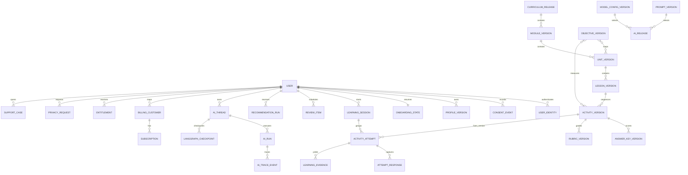

# Deutsch Mate MVP Database Contract

**Status:** implementation baseline
**Database:** PostgreSQL 16 on Amazon RDS, EU primary region
**Consumers:** NestJS Product API, NestJS workers, LangGraph.js workers
**Authority:** `docs/architecture.md`, then `docs/MVP_SCOPE.md`, then `docs/PRD.md`

## 1. Scope and ownership

PostgreSQL is the source of truth for account linkage, consent, learner state, released content, attempts, recommendations, AI workflow state and provenance, billing, entitlements, privacy operations, support, and audit evidence. Redis is disposable acceleration and coordination state. S3 stores immutable or large objects; PostgreSQL stores their ownership, classification, checksum, retention, and lifecycle state.

This contract includes only first-public-paid-release capabilities. Placement/readiness exams, speaking evidence, reminders, conversation-history UI, native mobile purchases, and dedicated assessment review are post-MVP and have no launch tables. Formative checks use the same versioned activity and attempt model as lessons.

Capability-owned schemas map directly to NestJS modules:

| Schema | NestJS module | Owns |
|---|---|---|
| `iam` | `IdentityModule` | Product users, Cognito linkage, roles, legal documents, consent |
| `learner` | `LearnerModule` | Profile versions, onboarding, proficiency |
| `content` | `ContentModule` | Immutable curriculum, lessons, activities, rubrics, releases |
| `learning` | `LearningModule` | Sessions, attempts, evidence, review, recommendations, progress |
| `ai` | `AiOrchestratorModule` | Prompts, model releases, LangGraph durability, traces |
| `billing` | `BillingModule` | Plans, provider state, subscriptions, entitlements |
| `media` | `MediaModule` | S3 object registry |
| `privacy` | `PrivacyModule` | Export/deletion requests and execution ledger |
| `support` | `SupportModule` | Categorized support cases |
| `ops` | `OperationsModule` | Idempotency, inbox/outbox, immutable audit |

No schema may write another schema's tables directly from application code. Cross-module changes go through the owning NestJS service in one database transaction. Workers use narrowly scoped database roles and inbox/outbox contracts.

## 2. PostgreSQL conventions

### 2.1 Extensions, identifiers, time, and common rules

Required extensions are `pgcrypto` (digests and random fallback), `citext` (normalized email), and `btree_gist` (non-overlapping effective ranges). Application migrations own extensions.

- Primary keys are UUIDv7 generated in TypeScript before insert. PostgreSQL 16 has no native UUIDv7 generator; use one shared package and reject non-v7 IDs in the repository layer. Database-generated UUIDs are limited to emergency tooling.
- All timestamps are `timestamptz`, stored in UTC. Business dates use `date`. Durations use integer milliseconds.
- Mutable rows have `created_at timestamptz NOT NULL DEFAULT now()`, `updated_at timestamptz NOT NULL DEFAULT now()`, and `lock_version integer NOT NULL DEFAULT 1 CHECK (lock_version > 0)`. Repositories update with `WHERE id = $id AND lock_version = $expected`, increment `lock_version`, and return HTTP 409 on zero rows.
- Immutable and append-only rows have `created_at` only. The database denies `UPDATE` and `DELETE` through triggers described in section 7.
- Money is integer minor units (`amount_minor bigint`) plus ISO-4217 `currency char(3)`; never floating point.
- JSON columns use `jsonb`, only for typed snapshots or provider payloads whose shape is validated by shared TypeScript/Zod schemas. Query-critical keys are normal columns.
- Human-readable version identifiers are positive integers unique within their stable aggregate key. Content hashes are lowercase SHA-256 hex (`char(64)`).
- `deleted_at` is not general-purpose soft deletion. It appears only where immediate access revocation must precede privacy erasure.
- Foreign keys default to `ON DELETE RESTRICT`. Explicit cascade is used only for unpublished operational children and is named below.
- Names use `snake_case`; TypeScript maps `numeric` to string and `bigint` to native `bigint`, never JavaScript `number`.

Every enum is created in its owning schema:

| Enum | Values |
|---|---|
| `iam.account_status` | `active`, `deletion_pending`, `deleted`, `blocked` |
| `iam.role_code` | `learner`, `content_editor`, `content_reviewer`, `support`, `privacy_operator`, `billing_operator`, `admin` |
| `iam.consent_decision` | `granted`, `withdrawn`, `declined` |
| `learner.cefr_level` | `A1`, `A2`, `B1`, `B2` |
| `learner.goal_code` | `relocation`, `work`, `study`, `travel`, `daily_life`, `general` |
| `content.release_status` | `draft`, `approved`, `published`, `retired` |
| `content.skill_code` | `reading`, `listening`, `writing`, `vocabulary`, `grammar` |
| `content.activity_type` | `explanation`, `selection`, `matching`, `ordering`, `cloze`, `typed_response`, `listening`, `writing`, `formative_check` |
| `content.transcript_policy` | `always`, `after_first_submission`, `after_completion`, `never` |
| `learning.session_status` | `active`, `completed`, `abandoned` |
| `learning.attempt_status` | `submitted`, `scored`, `feedback_pending`, `completed`, `feedback_unavailable` |
| `learning.evidence_validity` | `valid`, `invalid`, `unverified` |
| `learning.recommendation_kind` | `lesson`, `review`, `upgrade` |
| `ai.feature_code` | `tutor_chat`, `writing_correction`, `content_validation` |
| `ai.run_status` | `queued`, `running`, `succeeded`, `blocked`, `failed`, `timed_out`, `cancelled` |
| `ai.disposition` | `released`, `blocked`, `safe_failure`, `internal_only` |
| `ai.message_role` | `system`, `user`, `assistant`, `tool` |
| `billing.provider_code` | `stripe`, `apple`, `google`, `manual` |
| `billing.subscription_status` | `incomplete`, `trialing`, `active`, `past_due`, `paused`, `cancelled`, `unpaid` |
| `billing.entitlement_status` | `active`, `expired`, `revoked` |
| `media.object_state` | `pending_upload`, `available`, `quarantined`, `deletion_pending`, `deleted` |
| `media.data_class` | `lesson_audio`, `writing_attachment`, `ai_trace_content`, `privacy_export`, `audit_export` |
| `privacy.request_type` | `export`, `delete` |
| `privacy.request_status` | `requested`, `identity_verified`, `processing`, `completed`, `partially_retained`, `rejected`, `cancelled`, `failed` |
| `support.case_category` | `account`, `learning`, `privacy`, `billing` |
| `support.case_status` | `open`, `in_progress`, `waiting_for_user`, `resolved`, `closed` |
| `ops.delivery_status` | `pending`, `publishing`, `published`, `failed`, `dead_letter` |

`billing.subscription_status.trialing` is retained only for Stripe compatibility and possible future use; the MVP creates no trials.

## 3. Logical relationship diagram



## 4. Table contract

Notation: `PK` primary key, `FK schema.table(column)`, `UQ(...)`, and `CK(...)`. Every listed column is `NOT NULL` unless explicitly marked `NULL`; omitted defaults mean no default and the caller must supply a value. Common-column groups have exactly the nullability and defaults defined in section 2.

### 4.1 `iam`

**`iam.users`** — product identity boundary, not authentication credentials.

| Column | Contract |
|---|---|
| `id` | `uuid PK` |
| `status` | `iam.account_status NOT NULL DEFAULT 'active'` |
| `primary_email` | `citext NULL`; `UQ(primary_email) WHERE primary_email IS NOT NULL` |
| `interface_locale` | `varchar(16) NOT NULL DEFAULT 'en'` |
| `country_code` | `char(2) NULL` |
| `birth_year` | `smallint NULL CK (birth_year BETWEEN 1900 AND 2100)`; the API enforces adult age against the current date |
| `age_gate_confirmed_at` | `timestamptz NULL` |
| `pseudonym_key` | `uuid NOT NULL UQ`; stable analytics identifier, replaced on deletion |
| `created_at`, `updated_at`, `lock_version` | common mutable columns |
| `deleted_at` | `timestamptz NULL` |

**`iam.user_identities`** — OIDC subjects; no passwords or tokens.

| Column | Contract |
|---|---|
| `id` | `uuid PK` |
| `user_id` | `uuid FK iam.users(id)` |
| `issuer` | `text NOT NULL` |
| `subject` | `text NOT NULL` |
| `email_verified` | `boolean NOT NULL DEFAULT false` |
| `last_authenticated_at` | `timestamptz NULL` |
| `created_at`, `updated_at`, `lock_version` | common mutable columns |

Constraints: `UQ(issuer, subject)`. A user may have multiple future federated identities.

**`iam.user_roles`** — append-only grants and revocations.

`id uuid PK`; `user_id uuid FK iam.users`; `role iam.role_code`; `granted_by uuid NULL FK iam.users`; `granted_at timestamptz DEFAULT now()`; `revoked_by uuid NULL FK iam.users`; `revoked_at timestamptz NULL`; `reason text NOT NULL`; `CK(revoked_at IS NULL OR revoked_at >= granted_at)`; `UQ(user_id, role) WHERE revoked_at IS NULL`.

**`iam.legal_document_versions`** — immutable published legal text references.

`id uuid PK`; `document_code varchar(40)` (`terms`, `privacy`, `marketing`); `version integer CK(version>0)`; `locale varchar(16)`; `s3_object_id uuid FK media.objects`; `sha256 char(64)`; `published_at timestamptz`; `effective_at timestamptz`; `retired_at timestamptz NULL`; `created_by uuid FK iam.users`; `created_at`; `UQ(document_code, version, locale)`.

**`iam.consent_events`** — append-only legal evidence.

`id uuid PK`; `user_id uuid FK iam.users`; `document_version_id uuid NULL FK iam.legal_document_versions`; `purpose_code varchar(40)`; `decision iam.consent_decision`; `occurred_at timestamptz DEFAULT now()`; `source varchar(20)` (`web`, `ios`, `android`, `admin`); `ip_hash bytea NULL`; `user_agent_hash bytea NULL`; `correlation_id uuid`; `created_at`; `CK(document_version_id IS NOT NULL OR purpose_code='marketing')`. Current consent is the latest event by `(user_id,purpose_code,occurred_at,id)`, never an overwritten flag.

### 4.2 `learner`

**`learner.profile_versions`** — append-only user preferences.

`id uuid PK`; `user_id uuid FK iam.users`; `version integer CK(version>0)`; `goal learner.goal_code`; `selected_level learner.cefr_level`; `target_level learner.cefr_level NULL`; `study_minutes_per_day smallint NULL CK(BETWEEN 5 AND 180)`; `study_days_per_week smallint NULL CK(BETWEEN 1 AND 7)`; `preferences jsonb NOT NULL DEFAULT '{}' CK(jsonb_typeof(preferences)='object')`; `effective_at timestamptz DEFAULT now()`; `supersedes_id uuid NULL FK learner.profile_versions`; `created_at`; `UQ(user_id,version)`, `UQ(supersedes_id)`.

**`learner.onboarding_states`** — durable resumable projection.

`user_id uuid PK FK iam.users`; `step_code varchar(40) NOT NULL DEFAULT 'legal'`; `completed_steps jsonb NOT NULL DEFAULT '[]' CK(jsonb_typeof(...)='array')`; `completed_at timestamptz NULL`; `recommended_unit_version_id uuid NULL FK content.unit_versions`; common mutable columns.

**`learner.proficiency_snapshots`** — append-only, explicitly not certification.

`id uuid PK`; `user_id uuid FK iam.users`; `sequence integer CK(sequence>0)`; `algorithm_version varchar(40)`; `evidence_cutoff_at timestamptz`; `skill_vector jsonb` validated as `{skill:{estimate,uncertainty,evidenceCount}}`; `overall_estimate learner.cefr_level NULL`; `disclaimer_code varchar(40) NOT NULL DEFAULT 'cefr_estimate_not_certificate'`; `created_at`; `UQ(user_id,sequence)`.

`overall_estimate` remains `NULL` in MVP and is reserved for a separately validated post-MVP capability. The MVP API exposes skill- and objective-level evidence only.

### 4.3 `media`

**`media.objects`** — authoritative S3 registry; object bodies never enter PostgreSQL.

`id uuid PK`; `owner_user_id uuid NULL FK iam.users`; `data_class media.data_class`; `bucket_alias varchar(40)`; `object_key text`; `s3_version_id text NULL`; `state media.object_state DEFAULT 'pending_upload'`; `content_type text`; `size_bytes bigint NULL CK(size_bytes>=0)`; `sha256 char(64) NULL`; `kms_key_alias varchar(100)`; `retention_until timestamptz NULL`; `legal_hold boolean DEFAULT false`; `available_at timestamptz NULL`; `deletion_requested_at timestamptz NULL`; `deleted_at timestamptz NULL`; common mutable columns; `UQ(bucket_alias,object_key)`.

Only the media worker can move `pending_upload → available|quarantined` after `HEAD`, MIME allowlist, size, malware, and checksum verification. A deleted S3 object leaves a metadata tombstone with `state='deleted'`.

### 4.4 `content`

Stable content keys (`module_key`, `unit_key`, `lesson_key`, `activity_key`, `objective_key`) survive revisions. Each version row is immutable after creation; only release membership and release state determine client visibility.

**`content.curriculum_releases`**
`id uuid PK`; `release_key varchar(80)`; `version integer CK(version>0)`; `status content.release_status DEFAULT 'draft'`; `title text`; `description text`; `manifest_sha256 char(64)`; `approved_by uuid NULL FK iam.users`; `approved_at timestamptz NULL`; `published_by uuid NULL FK iam.users`; `published_at timestamptz NULL`; `retired_at timestamptz NULL`; `created_by uuid FK iam.users`; `created_at`; `UQ(release_key,version)`; state/timestamp consistency checks.

**`content.module_versions`**
`id uuid PK`; `module_key varchar(80)`; `version integer`; `level learner.cefr_level`; `title text`; `description text`; `ordinal smallint CK(ordinal>0)`; `created_by uuid FK iam.users`; `created_at`; `UQ(module_key,version)`.

**`content.release_modules`**
`release_id uuid FK content.curriculum_releases`; `module_version_id uuid FK content.module_versions`; `ordinal smallint CK(ordinal>0)`; `PK(release_id,module_version_id)`; `UQ(release_id,ordinal)`.

**`content.unit_versions`**
`id uuid PK`; `unit_key varchar(80)`; `version integer`; `module_key varchar(80)`; `level learner.cefr_level`; `title text`; `summary text`; `ordinal smallint CK(ordinal>0)`; `estimated_minutes smallint CK(BETWEEN 1 AND 180)`; `access_tier varchar(20) CK(IN ('free','premium'))`; `created_by uuid FK iam.users`; `created_at`; `UQ(unit_key,version)`.

**`content.module_units`**
`module_version_id uuid FK content.module_versions`; `unit_version_id uuid FK content.unit_versions`; `ordinal smallint`; `PK(module_version_id,unit_version_id)`; `UQ(module_version_id,ordinal)`.

**`content.objective_versions`**
`id uuid PK`; `objective_key varchar(100)`; `version integer`; `level learner.cefr_level`; `skill content.skill_code`; `title text`; `description text`; `created_by uuid FK iam.users`; `created_at`; `UQ(objective_key,version)`.

**`content.cefr_descriptor_versions`**
`id uuid PK`; `descriptor_key varchar(100)`; `version integer`; `level learner.cefr_level`; `skill content.skill_code`; `source_name text`; `source_edition text`; `descriptor_text text`; `created_at`; `UQ(descriptor_key,version)`.

**`content.unit_objectives`**
`unit_version_id uuid FK content.unit_versions`; `objective_version_id uuid FK content.objective_versions`; `is_primary boolean DEFAULT true`; `PK(unit_version_id,objective_version_id)`.

**`content.objective_descriptors`**
`objective_version_id uuid FK content.objective_versions`; `descriptor_version_id uuid FK content.cefr_descriptor_versions`; `PK(objective_version_id,descriptor_version_id)`.

**`content.unit_prerequisites`**
`unit_version_id uuid FK content.unit_versions`; `prerequisite_unit_version_id uuid FK content.unit_versions`; `PK(unit_version_id,prerequisite_unit_version_id)`; `CK(unit_version_id<>prerequisite_unit_version_id)`. Publication validation performs a recursive cycle check.

**`content.lesson_versions`**
`id uuid PK`; `lesson_key varchar(80)`; `version integer`; `unit_key varchar(80)`; `title text`; `explanation jsonb`; `examples jsonb`; `completion_rule jsonb`; `estimated_minutes smallint`; `created_by uuid FK iam.users`; `created_at`; `UQ(lesson_key,version)`. JSON fields are schema-validated rich-text ASTs, not HTML.

**`content.unit_lessons`**
`unit_version_id uuid FK content.unit_versions`; `lesson_version_id uuid FK content.lesson_versions`; `ordinal smallint`; `required boolean DEFAULT true`; `PK(unit_version_id,lesson_version_id)`; `UQ(unit_version_id,ordinal)`.

**`content.activity_versions`**
`id uuid PK`; `activity_key varchar(100)`; `version integer`; `type content.activity_type`; `level learner.cefr_level`; `prompt jsonb`; `configuration jsonb`; `max_score numeric(8,3) CK(max_score>=0)`; `required boolean DEFAULT true`; `transcript_policy content.transcript_policy NULL`; `created_by uuid FK iam.users`; `created_at`; `UQ(activity_key,version)`; listening requires a transcript policy and writing requires no deterministic answer key.

**`content.lesson_activities`**
`lesson_version_id uuid FK content.lesson_versions`; `activity_version_id uuid FK content.activity_versions`; `ordinal smallint`; `PK(lesson_version_id,activity_version_id)`; `UQ(lesson_version_id,ordinal)`.

**`content.activity_objectives`**
`activity_version_id uuid FK content.activity_versions`; `objective_version_id uuid FK content.objective_versions`; `weight numeric(5,4) CK(weight>0 AND weight<=1)`; `PK(activity_version_id,objective_version_id)`; deferred publication validation requires weights sum to `1.0000`.

**`content.activity_assets`**
`activity_version_id uuid FK content.activity_versions`; `media_object_id uuid FK media.objects`; `purpose varchar(30) CK(IN ('audio','image','attachment'))`; `ordinal smallint DEFAULT 1`; `alt_text text NULL`; `transcript jsonb NULL`; `PK(activity_version_id,media_object_id)`; `UQ(activity_version_id,purpose,ordinal)`.

**`content.answer_key_versions`**
`id uuid PK`; `activity_version_id uuid FK content.activity_versions`; `version integer`; `scoring_algorithm_version varchar(40)`; `answer_spec jsonb`; `rationale jsonb`; `max_score numeric(8,3)`; `created_by uuid FK iam.users`; `created_at`; `UQ(activity_version_id,version)`. `answer_spec` supports exact, case-folded, normalized, set, ordered, matching, and weighted alternatives; arbitrary executable expressions are forbidden.

**`content.rubric_versions`**
`id uuid PK`; `rubric_key varchar(100)`; `version integer`; `activity_version_id uuid NULL FK content.activity_versions`; `dimensions jsonb`; `scoring_rule jsonb`; `created_by uuid FK iam.users`; `created_at`; `UQ(rubric_key,version)`. MVP writing rubrics contain task completion, grammar, vocabulary, and clarity.

**`content.review_events`** — append-only governance.

`id uuid PK`; `aggregate_type varchar(30)`; `aggregate_id uuid`; `action varchar(20) CK(IN ('submitted','approved','rejected','published','retired','rollback_selected'))`; `actor_user_id uuid FK iam.users`; `qualification text NULL`; `validation_result jsonb`; `comment text NULL`; `occurred_at timestamptz DEFAULT now()`; `correlation_id uuid`; `created_at`. Publication service requires an `approved` event by an active `content_reviewer` before changing a release to `published`.

### 4.5 `learning`

**`learning.sessions`**
`id uuid PK`; `user_id uuid FK iam.users`; `curriculum_release_id uuid FK content.curriculum_releases`; `unit_version_id uuid FK content.unit_versions`; `lesson_version_id uuid NULL FK content.lesson_versions`; `client_platform varchar(20)`; `status learning.session_status DEFAULT 'active'`; `started_at timestamptz DEFAULT now()`; `last_activity_at timestamptz`; `completed_at timestamptz NULL`; common mutable metadata excluding duplicate `created_at`; `CK(completed_at IS NULL OR completed_at>=started_at)`.

**`learning.activity_attempts`** — append-only submission identity and version pin.

`id uuid PK`; `user_id uuid FK iam.users`; `session_id uuid FK learning.sessions`; `activity_version_id uuid FK content.activity_versions`; `answer_key_version_id uuid NULL FK content.answer_key_versions`; `rubric_version_id uuid NULL FK content.rubric_versions`; `attempt_number smallint CK(attempt_number>0)`; `client_attempt_id uuid`; `status learning.attempt_status`; `submitted_at timestamptz`; `duration_ms integer NULL CK(duration_ms>=0)`; `algorithm_version varchar(40)`; `correlation_id uuid`; `created_at`; `UQ(user_id,client_attempt_id)` and `UQ(user_id,activity_version_id,attempt_number)`. Stored `status` is the insertion-time submission disposition. The API attempt status is derived from the immutable attempt plus append-only feedback, score, and AI-run records; later outcomes never mutate `learning.activity_attempts`.

**`learning.attempt_responses`** — append-only learner answer.

`id uuid PK`; `attempt_id uuid FK learning.activity_attempts`; `response_kind varchar(20) CK(IN ('structured','text','choice'))`; `response jsonb NULL`; `text_content text NULL`; `content_expires_at timestamptz NULL`; `sha256 char(64)`; `created_at`; `UQ(attempt_id)`; exactly one of `response` and `text_content` is non-null. Raw writing expires after 90 days.

**`learning.attempt_scores`** — append-only scoring decisions.

`id uuid PK`; `attempt_id uuid FK learning.activity_attempts`; `score numeric(8,3)`; `max_score numeric(8,3) CK(max_score>=0)`; `passed boolean`; `scoring_method varchar(20) CK(IN ('deterministic','verified_ai'))`; `algorithm_version varchar(40)`; `details jsonb`; `supersedes_score_id uuid NULL FK learning.attempt_scores`; `created_at`; `UQ(supersedes_score_id)`. The current score is the non-superseded row; corrections preserve the original.

**`learning.feedback_records`** — append-only learner-visible feedback.

`id uuid PK`; `attempt_id uuid FK learning.activity_attempts`; `ai_run_id uuid NULL FK ai.runs`; `feedback_kind varchar(20) CK(IN ('deterministic','ai','unavailable'))`; `corrected_text text NULL`; `feedback jsonb`; `learner_disposition varchar(20) NULL CK(IN ('accepted','retried','dismissed'))`; `content_expires_at timestamptz NULL`; `created_at`. AI writing content expires after 90 days; the record then retains only categorical dimensions and hashes.

**`learning.evidence`** — append-only facts used by learner models.

`id uuid PK`; `user_id uuid FK iam.users`; `attempt_id uuid FK learning.activity_attempts`; `objective_version_id uuid FK content.objective_versions`; `score_ratio numeric(6,5) NULL CK(BETWEEN 0 AND 1)`; `validity learning.evidence_validity`; `reason_code varchar(40)`; `observed_at timestamptz`; `algorithm_version varchar(40)`; `created_at`; `UQ(attempt_id,objective_version_id,algorithm_version)`. Failed/unverified AI generates `invalid` or `unverified`, never `valid`.

**`learning.review_items`** — mutable rebuildable projection.

`id uuid PK`; `user_id uuid FK iam.users`; `objective_version_id uuid FK content.objective_versions`; `source_attempt_id uuid FK learning.activity_attempts`; `algorithm_version varchar(40)`; `due_at timestamptz`; `interval_days numeric(8,2)`; `ease numeric(6,3)`; `state varchar(20) CK(IN ('due','scheduled','completed','suspended'))`; `last_evidence_id uuid FK learning.evidence`; common mutable columns; `UQ(user_id,objective_version_id,source_attempt_id)`.

**`learning.recommendation_runs`** — immutable reproducibility snapshot.

`id uuid PK`; `user_id uuid FK iam.users`; `algorithm_version varchar(40)`; `profile_version_id uuid FK learner.profile_versions`; `proficiency_snapshot_id uuid NULL FK learner.proficiency_snapshots`; `entitlement_snapshot jsonb`; `candidate_snapshot jsonb`; `kind learning.recommendation_kind`; `recommended_unit_version_id uuid NULL FK content.unit_versions`; `recommended_review_item_id uuid NULL FK learning.review_items`; `reason_codes text[]`; `created_at`; target consistency check. Keep 400 days.

**`learning.unit_progress`** — mutable rebuildable projection, never evidence.

`user_id uuid FK iam.users`; `unit_version_id uuid FK content.unit_versions`; `completed_required integer DEFAULT 0`; `required_total integer`; `completion_ratio numeric(6,5)`; `completed_at timestamptz NULL`; `last_attempt_at timestamptz NULL`; common mutable columns; `PK(user_id,unit_version_id)`.

### 4.6 `ai`

**`ai.prompt_versions`** — immutable prompt registry.

`id uuid PK`; `prompt_key varchar(100)`; `version integer`; `feature ai.feature_code`; `template text`; `input_schema jsonb`; `output_schema jsonb`; `safety_policy_version varchar(40)`; `sha256 char(64)`; `status content.release_status DEFAULT 'draft'`; `created_by uuid FK iam.users`; `created_at`; `UQ(prompt_key,version)`.

**`ai.model_config_versions`** — immutable provider configuration; no secret values.

`id uuid PK`; `config_key varchar(100)`; `version integer`; `provider varchar(40)`; `model_name varchar(100)`; `provider_model_version varchar(100) NULL`; `parameters jsonb`; `max_input_tokens integer`; `max_output_tokens integer`; `timeout_ms integer`; `data_policy_code varchar(40)`; `created_by uuid FK iam.users`; `created_at`; `UQ(config_key,version)`.

**`ai.releases`** — approved feature routing.

`id uuid PK`; `feature ai.feature_code`; `version integer`; `prompt_version_id uuid FK ai.prompt_versions`; `model_config_version_id uuid FK ai.model_config_versions`; `verifier_prompt_version_id uuid NULL FK ai.prompt_versions`; `evaluation_result jsonb`; `status content.release_status`; `rollback_release_id uuid NULL FK ai.releases`; approval/publication actor and timestamp columns as in curriculum releases; `created_at`; `UQ(feature,version)`. Only one published release per feature via partial unique index.

**`ai.threads`** — durable graph namespace, not user-visible conversation history.

`id uuid PK`; `user_id uuid FK iam.users`; `feature ai.feature_code`; `context_unit_version_id uuid NULL FK content.unit_versions`; `retention_until timestamptz`; `closed_at timestamptz NULL`; `created_at`. MVP tutor threads expire after 30 days.

**`ai.runs`** — one graph invocation and top-level trace.

`id uuid PK`; `thread_id uuid FK ai.threads`; `user_id uuid FK iam.users`; `release_id uuid FK ai.releases`; `attempt_id uuid NULL FK learning.activity_attempts`; `status ai.run_status`; `disposition ai.disposition NULL`; `trace_id uuid UQ`; `correlation_id uuid`; `started_at timestamptz`; `first_verified_delta_at timestamptz NULL`; `completed_at timestamptz NULL`; `latency_ms integer NULL`; `input_tokens integer DEFAULT 0`; `output_tokens integer DEFAULT 0`; `estimated_cost_micros bigint DEFAULT 0`; `currency char(3) DEFAULT 'USD'`; `error_code varchar(80) NULL`; `verifier_summary jsonb NULL`; `content_expires_at timestamptz`; `created_at`. `first_verified_delta_at` records the first post-verification learner-visible SSE delta; provider first-token timing is internal telemetry only. Raw content expires after 30 days; provenance metadata remains 400 days.

**`ai.messages`** — encrypted-at-rest raw sensitive content.

`id uuid PK`; `run_id uuid FK ai.runs`; `sequence integer`; `role ai.message_role`; `content text NULL`; `content_sha256 char(64)`; `redaction_summary jsonb`; `expires_at timestamptz`; `created_at`; `UQ(run_id,sequence)`. Purge content at 30 days, retaining hash, role, timing, and redaction metadata.

**`ai.trace_events`** — append-only ordered provenance.

`id uuid PK`; `run_id uuid FK ai.runs`; `sequence integer`; `event_type varchar(40) CK(IN ('retrieval','tool_call','tool_result','model_call','model_result','verifier','stream','disposition','error'))`; `name text`; `metadata jsonb`; `sensitive_content_s3_id uuid NULL FK media.objects`; `started_at timestamptz`; `completed_at timestamptz NULL`; `created_at`; `UQ(run_id,sequence)`. Metadata includes source IDs/versions, allowlisted tool name, latency, tokens, and verdict, but no unrestricted learner content.

**`ai.langgraph_checkpoints`** — LangGraph durable checkpointer adapter.

`thread_id uuid FK ai.threads`; `checkpoint_ns text NOT NULL DEFAULT ''`; `checkpoint_id text`; `parent_checkpoint_id text NULL`; `checkpoint jsonb`; `metadata jsonb`; `channel_versions jsonb`; `created_at`; `PK(thread_id,checkpoint_ns,checkpoint_id)`. Checkpoint writes are immutable. Serialize only typed graph state; no credentials or signed URLs.

**`ai.langgraph_writes`** — pending/intermediate writes compatible with replay.

`thread_id uuid`; `checkpoint_ns text`; `checkpoint_id text`; `task_id text`; `idx integer`; `channel text`; `value jsonb`; `task_path text NOT NULL DEFAULT ''`; `created_at`; `PK(thread_id,checkpoint_ns,checkpoint_id,task_id,idx)`; composite FK to `ai.langgraph_checkpoints`. Delete only through the thread-retention workflow after the associated run is terminal.

### 4.7 `billing`

**`billing.plans`**
`id uuid PK`; `plan_code varchar(40) UQ`; `name text`; `active boolean DEFAULT true`; common mutable columns. Launch rows: `free`, `premium`.

**`billing.plan_prices`** — immutable commercial versions.

`id uuid PK`; `plan_id uuid FK billing.plans`; `provider billing.provider_code`; `provider_price_id text NULL`; `currency char(3)`; `amount_minor bigint CK(amount_minor>=0)`; `billing_interval varchar(10) CK(IN ('none','month','year'))`; `tax_behavior varchar(20) CK(IN ('inclusive','exclusive','unspecified'))`; `effective_from timestamptz`; `effective_to timestamptz NULL`; `created_at`; exclusion constraint prevents overlapping `(plan_id,provider,currency,billing_interval,tstzrange(...))`; `UQ(provider,provider_price_id) WHERE provider_price_id IS NOT NULL`.

**`billing.plan_features`** — versioned server-side allowance configuration.

`id uuid PK`; `plan_id uuid FK billing.plans`; `feature_code varchar(60)`; `config_version integer`; `limit_value bigint NULL`; `limit_period varchar(20) NULL CK(IN ('day','month','billing_period'))`; `enabled boolean`; `effective_from timestamptz`; `effective_to timestamptz NULL`; `created_at`; non-overlap exclusion by plan/feature.

**`billing.customers`**
`id uuid PK`; `user_id uuid FK iam.users`; `provider billing.provider_code`; `provider_customer_id text`; common mutable columns; `UQ(user_id,provider)`, `UQ(provider,provider_customer_id)`.

**`billing.checkout_sessions`** — internal purchase command and provider redirect lifecycle.

`id uuid PK`; `user_id uuid FK iam.users`; `provider billing.provider_code DEFAULT 'stripe'`; `plan_price_id uuid FK billing.plan_prices`; `provider_checkout_id text NULL`; `status varchar(20) DEFAULT 'creating' CK(IN ('creating','open','completed','expired','failed'))`; `success_url_hash char(64)`; `cancel_url_hash char(64)`; `expires_at timestamptz`; `completed_at timestamptz NULL`; `idempotency_key_id uuid FK ops.idempotency_keys`; `last_error_code varchar(80) NULL`; common mutable columns; `UQ(provider,provider_checkout_id) WHERE provider_checkout_id IS NOT NULL`, `UQ(idempotency_key_id)`. Only allowlisted application return origins are accepted; full URLs are not retained.

**`billing.subscriptions`**
`id uuid PK`; `customer_id uuid FK billing.customers`; `provider_subscription_id text`; `plan_price_id uuid FK billing.plan_prices`; `status billing.subscription_status`; `provider_event_created_at timestamptz`; `current_period_start timestamptz NULL`; `current_period_end timestamptz NULL`; `cancel_at_period_end boolean DEFAULT false`; `cancelled_at timestamptz NULL`; `ended_at timestamptz NULL`; `reconciled_at timestamptz NULL`; `provider_snapshot jsonb`; common mutable columns; `UQ(customer_id,provider_subscription_id)`.

**`billing.entitlements`** — ordinary request-time access source.

`id uuid PK`; `user_id uuid FK iam.users`; `feature_code varchar(60)`; `source_provider billing.provider_code`; `source_subscription_id uuid NULL FK billing.subscriptions`; `status billing.entitlement_status`; `valid_from timestamptz`; `valid_until timestamptz NULL`; `allowance jsonb`; common mutable columns; exclusion constraint prevents overlapping active ranges for `(user_id,feature_code,source_provider)`.

**`billing.entitlement_events`** — append-only effective transition ledger.

`id uuid PK`; `entitlement_id uuid FK billing.entitlements`; `webhook_event_id uuid NULL FK billing.webhook_events DEFERRABLE`; `action varchar(20) CK(IN ('grant','change','expire','revoke','reconcile'))`; `before_state jsonb`; `after_state jsonb`; `reason_code varchar(40)`; `occurred_at timestamptz DEFAULT now()`; `created_at`.

**`billing.usage_events`** — append-only premium allowance debits and credits.

`id uuid PK`; `user_id uuid FK iam.users`; `entitlement_id uuid FK billing.entitlements`; `feature_code varchar(60)`; `quantity bigint CK(quantity<>0)`; `unit varchar(20) CK(IN ('request','token','item'))`; `period_start timestamptz`; `period_end timestamptz`; `source_type varchar(30)`; `source_id uuid`; `idempotency_key varchar(128)`; `occurred_at timestamptz DEFAULT now()`; `created_at`; `UQ(entitlement_id,feature_code,idempotency_key)`. Credits are negative quantities that reference the failed/cancelled source in `source_id`. A transaction takes an advisory lock scoped to entitlement/feature/period, sums durable usage, and inserts the debit before work is accepted; Redis may cache the sum only.

**`billing.webhook_events`** — signed webhook ledger.

`id uuid PK`; `provider billing.provider_code`; `provider_event_id text`; `event_type text`; `provider_created_at timestamptz`; `signature_verified_at timestamptz`; `payload jsonb`; `payload_sha256 char(64)`; `received_at timestamptz DEFAULT now()`; `processing_status varchar(20) DEFAULT 'received' CK(IN ('received','processing','processed','ignored','failed','dead_letter'))`; `attempt_count integer DEFAULT 0`; `processed_at timestamptz NULL`; `next_attempt_at timestamptz NULL`; `last_error_code varchar(80) NULL`; `last_error_detail text NULL`; `correlation_id uuid`; common mutable metadata excluding duplicate `created_at`; `UQ(provider,provider_event_id)`. Insert occurs only after signature verification. The transaction locks this row, applies subscription and entitlement state only if the incoming provider timestamp/version wins, appends an entitlement event and outbox event, then marks processed.

**`billing.reconciliation_runs`** — durable scheduled reconciliation summary.

`id uuid PK`; `provider billing.provider_code`; `started_at timestamptz DEFAULT now()`; `completed_at timestamptz NULL`; `status varchar(20) DEFAULT 'running' CK(IN ('running','completed','failed'))`; `cursor text NULL`; `checked_count integer DEFAULT 0`; `mismatch_count integer DEFAULT 0`; `repaired_count integer DEFAULT 0`; `alerted_count integer DEFAULT 0`; `last_error text NULL`; `created_at`.

**`billing.reconciliation_items`** — append-only mismatch evidence.

`id uuid PK`; `run_id uuid FK billing.reconciliation_runs`; `subscription_id uuid NULL FK billing.subscriptions`; `provider_object_id text`; `mismatch_code varchar(60)`; `internal_snapshot jsonb`; `provider_snapshot jsonb`; `resolution varchar(20) CK(IN ('repaired','alerted','no_change'))`; `entitlement_event_id uuid NULL FK billing.entitlement_events`; `created_at`; `UQ(run_id,provider_object_id,mismatch_code)`. The daily job must complete within 24 hours or page billing operations.

### 4.8 `privacy`, `support`, and `ops`

**`privacy.requests`**
`id uuid PK`; `user_id uuid FK iam.users`; `type privacy.request_type`; `status privacy.request_status DEFAULT 'requested'`; `requested_at timestamptz DEFAULT now()`; `identity_verified_at timestamptz NULL`; `due_at timestamptz` (request + 30 days); `completed_at timestamptz NULL`; `export_object_id uuid NULL FK media.objects`; `retention_exceptions jsonb`; `failure_code varchar(80) NULL`; common mutable metadata excluding duplicate `created_at`.

**`privacy.request_events`** — append-only workflow audit.

`id uuid PK`; `request_id uuid FK privacy.requests`; `from_status privacy.request_status NULL`; `to_status privacy.request_status`; `actor_user_id uuid NULL FK iam.users`; `details jsonb`; `occurred_at timestamptz DEFAULT now()`; `created_at`.

**`privacy.erasure_tasks`**
`id uuid PK`; `request_id uuid FK privacy.requests`; `system_code varchar(40) CK(IN ('postgres','cognito','s3','redis','stripe_metadata','analytics','backups'))`; `status varchar(20) CK(IN ('pending','running','completed','retained','failed'))`; `attempt_count integer DEFAULT 0`; `retention_until timestamptz NULL`; `evidence jsonb`; `completed_at timestamptz NULL`; common mutable columns; `UQ(request_id,system_code)`.

**`support.cases`**
`id uuid PK`; `user_id uuid NULL FK iam.users`; `category support.case_category`; `status support.case_status DEFAULT 'open'`; `subject text`; `description text`; `contact_email citext NULL`; `ai_run_id uuid NULL FK ai.runs`; `assigned_to uuid NULL FK iam.users`; `resolved_at timestamptz NULL`; common mutable columns. Description is encrypted at rest and purged 24 months after closure.

**`support.case_events`** — append-only notes/status history.

`id uuid PK`; `case_id uuid FK support.cases`; `actor_user_id uuid NULL FK iam.users`; `event_type varchar(20) CK(IN ('created','status_changed','note','assigned','resolved'))`; `body text NULL`; `metadata jsonb`; `created_at`.

**`ops.idempotency_keys`** — API idempotency result store.

`id uuid PK`; `scope varchar(60)`; `actor_user_id uuid NULL FK iam.users`; `key varchar(128)`; `request_hash char(64)`; `state varchar(20) CK(IN ('processing','completed','failed'))`; `response_status smallint NULL`; `response_body jsonb NULL`; `resource_type varchar(50) NULL`; `resource_id uuid NULL`; `locked_until timestamptz`; `expires_at timestamptz`; `created_at`, `updated_at`; `UQ(scope,actor_user_id,key) NULLS NOT DISTINCT`. Reuse with a different request hash returns 409. Attempts and purchases retain keys 400 days; other commands 24 hours.

**`ops.outbox_events`** — transactional publisher source.

`id uuid PK`; `aggregate_type varchar(50)`; `aggregate_id uuid`; `event_type varchar(100)`; `event_version smallint`; `payload jsonb`; `headers jsonb`; `correlation_id uuid`; `causation_id uuid NULL`; `occurred_at timestamptz`; `available_at timestamptz DEFAULT now()`; `status ops.delivery_status DEFAULT 'pending'`; `attempt_count integer DEFAULT 0`; `locked_until timestamptz NULL`; `published_at timestamptz NULL`; `last_error text NULL`; `created_at`. Business mutation and insert are one transaction. Publisher uses `FOR UPDATE SKIP LOCKED`; rows are retained 30 days after publication and archived to S3 before purge.

**`ops.inbox_events`** — consumer deduplication and replay ledger.

`id uuid PK`; `consumer_name varchar(100)`; `message_id uuid`; `event_type varchar(100)`; `payload_sha256 char(64)`; `received_at timestamptz DEFAULT now()`; `processed_at timestamptz NULL`; `status varchar(20) CK(IN ('processing','processed','failed','dead_letter'))`; `attempt_count integer DEFAULT 0`; `last_error text NULL`; `result jsonb NULL`; `created_at`; `UQ(consumer_name,message_id)`. Inbox claim and consumer side effects share one transaction.

**`ops.audit_events`** — append-only privileged and integrity audit.

`id uuid PK`; `occurred_at timestamptz DEFAULT now()`; `actor_user_id uuid NULL FK iam.users`; `actor_type varchar(20) CK(IN ('user','staff','service','provider'))`; `action varchar(100)`; `resource_type varchar(60)`; `resource_id uuid NULL`; `outcome varchar(20) CK(IN ('success','denied','failed'))`; `reason_code varchar(60) NULL`; `correlation_id uuid`; `ip_hash bytea NULL`; `metadata jsonb`; `previous_hash char(64) NULL`; `event_hash char(64)`; `created_at`. A daily signed manifest is exported to S3 Object Lock. Metadata must not contain raw learner content, tokens, secrets, or signed URLs.

## 5. Required indexes

Primary, unique, exclusion, and foreign-key target indexes are implied. Add:

```sql
CREATE INDEX ON iam.consent_events (user_id, purpose_code, occurred_at DESC, id DESC);
CREATE INDEX ON learner.profile_versions (user_id, version DESC);
CREATE INDEX ON content.curriculum_releases (status, published_at DESC);
CREATE INDEX ON content.unit_versions (level, module_key, ordinal);
CREATE INDEX ON content.activity_objectives (objective_version_id, activity_version_id);
CREATE INDEX ON learning.sessions (user_id, last_activity_at DESC);
CREATE INDEX ON learning.activity_attempts (user_id, submitted_at DESC);
CREATE INDEX ON learning.activity_attempts (session_id, submitted_at);
CREATE INDEX ON learning.evidence (user_id, objective_version_id, observed_at DESC);
CREATE INDEX ON learning.review_items (user_id, due_at) WHERE state IN ('due','scheduled');
CREATE INDEX ON learning.recommendation_runs (user_id, created_at DESC);
CREATE INDEX ON ai.runs (user_id, created_at DESC);
CREATE INDEX ON ai.runs (status, started_at) WHERE status IN ('queued','running');
CREATE INDEX ON ai.trace_events (run_id, sequence);
CREATE INDEX ON ai.langgraph_checkpoints (thread_id, checkpoint_ns, created_at DESC);
CREATE UNIQUE INDEX ai_one_published_release_per_feature
  ON ai.releases (feature) WHERE status = 'published';
CREATE INDEX ON billing.subscriptions (status, reconciled_at);
CREATE INDEX ON billing.entitlements (user_id, feature_code, valid_until)
  WHERE status = 'active';
CREATE INDEX ON billing.usage_events (entitlement_id, feature_code, period_start, period_end);
CREATE INDEX ON billing.webhook_events (processing_status, next_attempt_at)
  WHERE processing_status IN ('received','failed');
CREATE INDEX ON billing.reconciliation_runs (provider, started_at DESC);
CREATE INDEX ON privacy.requests (status, due_at)
  WHERE status NOT IN ('completed','partially_retained','rejected','cancelled');
CREATE INDEX ON ops.outbox_events (available_at, occurred_at)
  WHERE status IN ('pending','failed');
CREATE INDEX ON ops.inbox_events (consumer_name, status, received_at);
CREATE INDEX ON ops.audit_events (resource_type, resource_id, occurred_at DESC);
```

Do not add general GIN indexes to JSONB. Add expression or GIN indexes only from measured query plans, with a migration and ownership note. Every non-cascade FK receives a child-side index if used for deletion checks or joins.

## 6. Transaction and idempotency contracts

1. **Scored activity:** claim `ops.idempotency_keys`; lock the session; insert attempt, response, deterministic score/evidence, review projection update, progress projection update, and outbox rows; commit; cache invalidation is asynchronous. Duplicate `client_attempt_id` returns the original resource.
2. **AI writing:** insert attempt/response and AI run transactionally; worker claims an inbox event, writes checkpoints/traces, then in one terminal transaction inserts feedback, verified score/evidence if eligible, terminal outbox event, and inbox completion. Timeout creates `feedback_unavailable`; it never creates valid mastery.
3. **Tutor:** idempotency scope is `(user, thread, client_message_id)`. Stream fragments may be ephemeral, but the final disposition and trace are durable before the client receives completion.
4. **Checkout creation:** idempotency covers internal checkout command and Stripe idempotency key. Store only provider IDs; entitlement changes occur from verified webhook/reconciliation state, not browser redirects.
5. **Webhook:** `UQ(provider,provider_event_id)` is the first dedupe boundary. Reordered events compare provider object version/creation time and refresh from Stripe when ambiguous.
6. **Outbox/inbox:** delivery is at least once; effects are exactly once per consumer/message through the inbox unique key. Dead-letter changes ledger state and emits an alert; it never deletes evidence.

Use `READ COMMITTED` by default, row locks for aggregate updates, and `SERIALIZABLE` with bounded retry only for entitlement range changes and release publication. No distributed transaction spans PostgreSQL, Redis, S3, Stripe, or queues.

## 7. Immutability, append-only evidence, and publication

Database trigger `ops.forbid_mutation()` raises SQLSTATE `55000` on `UPDATE` or `DELETE` for:

- all `content.*_versions`, mapping tables once referenced by a published release, `content.review_events`;
- `learner.profile_versions`, `learner.proficiency_snapshots`;
- `learning.activity_attempts`, responses, scores, feedback, evidence, recommendation runs;
- `ai.prompt_versions`, model config versions, released `ai.releases`, trace events, checkpoint rows;
- consent, role grant history, entitlement and usage events, reconciliation items, privacy request events, case events, and audit events.

The migration owner can bypass only in an audited maintenance transaction with `SET LOCAL app.maintenance_ticket` and a database role unavailable to application workloads. Normal correction means append a superseding fact/version. Published content is selected only through a `published` release. Rollback publishes/selects a previously approved immutable release; it never rewrites attempts or release history.

Publication runs deferred validators that enforce: six units per launch module; objectives and CEFR descriptors present; acyclic prerequisites; lesson ordering; required activity count; listening asset/transcript policy; one writing task and formative check per unit; score/rubric coverage; objective weights; all S3 assets available with checksums; reviewer approval; and manifest hash match.

## 8. Authorization and RLS

Connection roles:

- `dm_migrator`: DDL only in deployment jobs; no runtime login.
- `dm_api`: Product API, subject to RLS and schema grants.
- `dm_ai_worker`, `dm_billing_worker`, `dm_media_worker`, `dm_privacy_worker`, `dm_outbox_worker`: least-privilege table grants.
- `dm_read_replica`: redacted reporting views only.

The API starts every transaction with `SET LOCAL app.user_id = '<uuid>'`, `app.roles = 'learner,...'`, and `app.correlation_id`. Values come from verified OIDC claims plus database role lookup, never request fields. RLS is enabled and forced on every table containing `user_id` or `owner_user_id`.

Learner policy is equivalent to:

```sql
USING (user_id = nullif(current_setting('app.user_id', true), '')::uuid)
WITH CHECK (user_id = nullif(current_setting('app.user_id', true), '')::uuid)
```

Child tables without `user_id` use an `EXISTS` policy through their parent. Public content views expose only published releases and associated immutable rows. Staff policies require both an active `iam.user_roles` grant and the matching database/application capability; `admin` is not an RLS bypass. Privacy and support operators see only assigned or purpose-authorized cases. Billing workers cannot read learning content; AI workers receive only the minimum profile/content views and cannot read billing payloads. Only the database owner can bypass RLS, and runtime roles are never owners.

Security-definer functions are owned by a no-login role, pin `search_path`, qualify every object, reject caller-supplied user IDs, and receive explicit grants. Cross-user authorization tests cover all user-owned tables and views.

## 9. Redis contract

Redis contains no irreplaceable business state. Keys use `dm:{env}:{capability}:{purpose}:{partition}:{id}[:{version}]`, lowercase ASCII, with the user UUID hashed for keys visible to infrastructure telemetry. Values are versioned JSON/msgpack envelopes `{v, createdAt, expiresAt, payload}`.

| Pattern | TTL | Rule |
|---|---:|---|
| `dm:{env}:auth:rate:{route}:{subjectHash}` | 1–15 min | Sliding-window counter; fail closed only for abusive routes |
| `dm:{env}:learning:session:{userHash}:{sessionId}` | 30 min | Cache of PostgreSQL session; cache miss reloads |
| `dm:{env}:content:release:{releaseId}` | 24 h | Immutable content cache, safe to retain until TTL |
| `dm:{env}:learning:review:{userHash}` | 5 min | Rebuild from review items |
| `dm:{env}:ai:stream:{runId}` | 15 min | Partial stream only; terminal result in PostgreSQL |
| `dm:{env}:ai:checkpoint:{threadId}` | 10 min | Read-through cache of PostgreSQL checkpoint |
| `dm:{env}:lock:{resource}:{id}` | operation timeout + 30 s | Token-valued lock; compare-and-delete Lua release |
| `dm:{env}:jobs:dedupe:{consumer}:{messageId}` | 24 h | Optimization; PostgreSQL inbox is authoritative |
| `dm:{env}:entitlement:{userHash}` | 2 min | Read-through; webhook invalidates after commit |

Never store raw chat, writing, email, access/refresh tokens, Stripe payloads, or signed S3 URLs in Redis. Use TLS, KMS encryption, ACLs by workload, no cross-environment sharing, and an eviction policy suitable for caches (`allkeys-lfu`). A total Redis flush is a tested non-data-loss event.

## 10. S3 object contract

Buckets are separate by environment and data class: private media, immutable evidence/audit, exports, and analytics. All block public access, require TLS, SSE-KMS, bucket-owner-enforced ownership, versioning, access logging, and deny unencrypted writes.

Object keys are opaque and contain no email or display name:

```text
content/{releaseId}/{mediaObjectId}/{sha256}
learner/{userShard}/{userPseudonym}/{dataClass}/{yyyy}/{mm}/{mediaObjectId}
ai-trace/{yyyy}/{mm}/{dd}/{runId}/{traceEventId}.json.enc
privacy-export/{userShard}/{requestId}/{exportId}.zip
audit/{yyyy}/{mm}/{dd}/{manifestId}.jsonl.gz
```

`userShard` is the first two hex characters of SHA-256(user UUID). Presigned upload URLs permit one exact key, MIME family, checksum, and maximum size; expire after 10 minutes. Download URLs expire after 5 minutes and are never logged. Clients cannot choose bucket/key or set retention metadata.

Content and audit objects use S3 Object Lock governance mode: content for the lifetime of any release plus 7 years; audit manifests 7 years. Privacy exports expire after 7 days. AI raw trace objects expire after 30 days. Incidental learner attachments/raw writing objects expire after 90 days. S3 lifecycle transitions eligible immutable evidence to colder storage after 90 days. PostgreSQL deletion tasks remove all versions and delete markers where legally permitted; Object Lock/legal hold produces a documented retention exception.

## 11. Retention, deletion, and pseudonymization

Launch retention is fixed as follows; changing it requires privacy review, a migration/config release, and updated notices.

| Data | Active retention |
|---|---|
| Account/profile/consent | Account life; required consent evidence 7 years after account deletion |
| Deterministic attempts, scores, objective evidence | Account life; pseudonymized aggregate facts may remain after deletion |
| Raw writing, correction text, learner attachments | 90 days |
| Tutor threads/messages and raw AI trace content | 30 days |
| AI provenance without raw content | 400 days |
| Recommendation snapshots and idempotency for attempts/purchases | 400 days |
| Billing subscription, webhook, entitlement and invoice references | 10 years after relevant fiscal year, without card data |
| Privileged/audit events | 7 years |
| Support case content | 24 months after closure; billing/privacy case metadata follows longer legal retention where required |
| Outbox payloads | 30 days after publish, then 1 year in immutable S3 operations archive |
| Privacy exports | 7 days after creation |
| LangGraph checkpoints/writes | 30 days after thread closure; immediately eligible when a failed run has no investigation hold |

Deletion immediately changes `iam.users.status` to `deletion_pending`, revokes sessions at Cognito, denies RLS access, withdraws optional consent, and enqueues erasure tasks. Within 30 days:

1. delete raw messages, writing, feedback text, checkpoints, support text when no exception applies, Redis keys, and eligible S3 versions;
2. replace email, OIDC subject, contact fields, IP/user-agent hashes, and provider metadata not legally required with null or keyed tombstones;
3. rotate `pseudonym_key`; retain `iam.users` as a blocked, identifier-free tombstone so foreign keys and historical evidence remain internally consistent without a re-identification mapping;
4. retain billing/legal/audit facts linked only to that random tombstone, inaccessible to product paths and containing no direct identifiers;
5. write only request/task IDs, counts, timestamps, policy codes, and checksums to erasure evidence—never copies of erased content.

Analytics receives only `pseudonym_key`, coarse region, content/version IDs, scores, and timestamps bucketed as necessary. It never receives raw chat, writing, audio, email, OIDC subject, provider payload, or signed URL. Backups are not edited in place: deleted-subject tombstones are retained in a separate encrypted suppression ledger for the backup lifetime and replayed immediately after any restore before traffic is enabled.

## 12. Migrations, backup, and restore

- Use forward-only SQL migrations generated and reviewed alongside TypeScript entities. A migration table records name, SHA-256, deployed commit, actor, and timestamp.
- CI creates PostgreSQL 16 from empty, upgrades a production-shaped previous snapshot, validates constraints/RLS, and runs downgrade-by-application-compatibility tests. ORM auto-sync is forbidden outside throwaway local databases.
- Expand/contract deployments: add nullable/default-free columns or new tables; deploy dual-read/write code; backfill in bounded `SKIP LOCKED` batches; validate `NOT VALID` constraints; switch reads; remove old shape in a later release.
- Create indexes `CONCURRENTLY` outside transaction. Add foreign keys/checks `NOT VALID`, then `VALIDATE CONSTRAINT`. Set statement/lock timeouts. Never add a volatile default or full-table rewrite during peak traffic.
- PostgreSQL application and worker versions maintain one-release backward compatibility. Content and event schema versions are independent of database migration numbers.
- Production RDS is Multi-AZ with automated backups and continuous WAL archiving. Configure PITR for 35 days, daily snapshots for 35 days, monthly cross-account/cross-region copies for 12 months, and annual copies for 7 years where billing/audit law requires.
- Target RPO is at most 5 minutes. The initial RTO target is 4 hours. Quarterly restore drills restore into an isolated account/VPC, verify checksums, migrations, RLS, row counts, outbox/inbox consistency, S3 references, and application smoke tests.
- Before restored production opens, apply deletion suppression tombstones, rotate database credentials, disable outbox publishing, reconcile Stripe, validate Cognito linkage, then resume publishers from a recorded boundary. A restore never treats Redis as an input.
- Logical exports are for portability, not primary recovery. Backups and exports use distinct KMS keys, least-privilege restore roles, CloudTrail, and tested key-recovery procedures.

## 13. Requirement mapping

| Requirement | Contract coverage |
|---|---|
| FR-001–003 | `iam.users`, identities, legal/consent events; profile/proficiency versions; deletion workflow |
| FR-010 | Durable onboarding state and profile version pin |
| FR-020–023 | Immutable releases, modules, units, objectives/descriptors, lessons, activities, assets, answer keys |
| FR-024 | Writing attempts/responses, AI run and verifier provenance, feedback retention, no invalid mastery |
| FR-030–032 | Evidence, review projection, reproducible recommendations, progress/proficiency separation |
| FR-040–041 | AI releases, threads/runs/messages/traces, bounded tool events, LangGraph durability, content expiry |
| FR-050, FR-052 | Formative activity versions, deterministic keys/rubrics, evidence and estimate disclaimer |
| FR-060–063 | Versioned plans/prices/features, Stripe customer/subscription, webhook ledger, internal entitlements |
| FR-070 | Privacy requests/events/tasks, export object, deletion suppression and retention exceptions |
| FR-071 | Categorized support cases and append-only case events |
| FR-072 | Immutable content/prompt/model versions, approvals, release and rollback events |
| NFR-003–004 | PostgreSQL authority, reconstructable Redis, immutable S3, PITR/restore, deterministic outage path |
| NFR-005–006 | RLS, least privilege, signed media, audit, retention, export/deletion/pseudonymization |
| NFR-007–008 | Full AI provenance, raw-content expiry, evaluation result and rollback release |
| NFR-011–012 | Correlation IDs, idempotency keys, inbox/outbox, webhook and entitlement ledgers |
| NFR-014 | Trigger-enforced immutable/versioned content and append-only historical resolution |
| NFR-015–016 | PostgreSQL 16 migration contract, TypeScript-safe types, isolated EU environments |
| Gates G1–G8 | Publication validators, recovery drills, RLS tests, billing disorder tests, operational ledgers |

## 14. Explicit implementation boundaries

- Kysely generated database types and repository adapters are persistence aids, not the domain contract; explicit SQL migrations and this document govern nullability and constraints.
- API DTOs never expose provider payloads, internal hashes, storage keys, raw audit metadata, or another user's identifiers.
- Read replicas serve redacted reporting and content reads tolerant of lag; entitlement, consent, attempt submission, recommendation generation, and privacy workflows always use the writer.
- Partitioning is not required at launch. Reassess monthly range partitioning for `ops.audit_events`, `ai.trace_events`, outbox/inbox, and attempts only after measured table/index growth justifies the operational cost.
- Post-MVP exam and speech tables require a separate reviewed migration; do not overload formative activities, writing responses, or generic JSON to simulate those capabilities.
