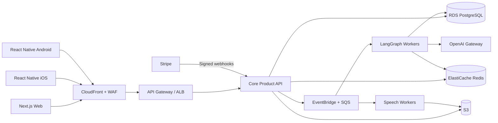

# AI-Powered German Learning Platform Architecture

## Executive summary

Build the transactional product as a modular monolith and run AI, speech, analytics, notifications, and exam generation as independently scalable asynchronous workers. PostgreSQL is the system of record, Redis contains disposable state only, and S3 stores immutable media and evidence.

The platform supports:

- Web through Next.js
- Android and iOS through React Native with native audio and in-app-purchase adapters
- LangGraph for durable AI workflows
- OpenAI behind an internal AI gateway
- PostgreSQL, Redis, and S3 for persistence
- AWS ECS Fargate for compute
- Stripe Checkout and Billing for web subscriptions
- Blueprint-led, AI-generated CEFR assessments with deterministic, model-based, psychometric, and human validation

## System context

## Architecture principles

1. Start with a modular monolith for transactional APIs. Extract a service only when ownership, scaling, reliability, or deployment cadence justifies the operational cost.
2. Keep long-running AI, speech, media, analytics, and notification jobs asynchronous.
3. Treat PostgreSQL as the consistency anchor. Redis must never be the only copy of an exam attempt, subscription, or learner result.
4. Put every model behind an internal AI gateway. Clients and product modules never call OpenAI directly.
5. Version all prompts, models, rubrics, exam blueprints, generated items, and scoring rules.
6. Use human and psychometric governance for consequential CEFR decisions.
7. Prefer graceful degradation: curriculum and deterministic practice remain available during AI outages.

## Client applications

### Web

- Next.js for public acquisition pages and the authenticated application
- Server rendering for SEO-sensitive pages
- REST for standard product operations
- WebSocket or Server-Sent Events for streaming tutor responses
- Presigned S3 uploads for audio and large files

### Android and iOS

- React Native for shared product code
- Native adapters for recording, audio playback, background behavior, notifications, accessibility, and purchases
- Generated API clients from the platform OpenAPI specification
- Local encrypted storage for short-lived credentials and offline lesson metadata
- Cached deterministic exercises for limited offline use

Apple App Store and Google Play billing rules must be evaluated separately from Stripe. Stripe Checkout is appropriate for web subscriptions but does not automatically satisfy mobile store policies.

## Backend capabilities

| Capability | Runtime | Responsibilities | Primary state |
|---|---|---|---|
| Identity and Profile | Cognito plus Product API | Users, roles, consent, locale, goals, CEFR profile | PostgreSQL |
| Learning | Product API module | Curriculum, lessons, sessions, spaced repetition, learner model | PostgreSQL and Redis |
| Assessment | Product API plus workers | Exam assembly, delivery, scoring, appeals | PostgreSQL and S3 |
| AI Orchestrator | LangGraph workers | Tutor, correction, content generation, exam workflows | PostgreSQL and Redis |
| Speech | Asynchronous workers | Speech-to-text, text-to-speech, pronunciation evidence | S3 and PostgreSQL |
| Billing | Product API plus webhook worker | Subscriptions, invoices, reconciliation, entitlements | PostgreSQL |
| Analytics | Event pipeline | Product events, learning outcomes, experimentation | S3 and warehouse |
| Notifications | Asynchronous workers | Email, push, reminders, transactional messages | SQS and PostgreSQL |

Modules communicate synchronously inside the Product API. Cross-process communication uses domain events published through a transactional outbox to EventBridge and SQS. Each consumer must support idempotency, retries, dead-letter queues, and replay.

## AWS deployment

### Accounts and networking

- Separate development, staging, and production AWS accounts
- EU primary region for the initial product
- Three availability zones
- Public subnets only for load balancers and managed edge ingress
- Private subnets for application compute, databases, Redis, and workers
- VPC endpoints where practical to reduce public egress
- Infrastructure defined with AWS CDK or Terraform

### Managed services

- CloudFront for content delivery
- AWS WAF for edge filtering, bot controls, and rate limiting
- Application Load Balancer and API Gateway for HTTP and streaming routes
- ECS Fargate for Product API and workers
- RDS PostgreSQL Multi-AZ with point-in-time recovery
- ElastiCache Redis
- S3 with versioning and lifecycle policies
- EventBridge and SQS for asynchronous events
- Cognito for OIDC identity
- Secrets Manager and KMS
- CloudWatch plus OpenTelemetry-compatible observability
- CloudTrail for AWS audit logs

ECS Fargate is preferable to Kubernetes initially because it provides independent service scaling without requiring a Kubernetes operating model. Reconsider EKS only when workload or platform-team requirements justify it.

## API design

- Versioned REST endpoints for product operations
- WebSocket or Server-Sent Events for tutor streaming
- OpenAPI as the client contract
- Idempotency keys for learning attempts, exam submission, purchases, and webhook processing
- Cursor-based pagination
- Optimistic concurrency for mutable user-owned resources
- Correlation IDs propagated through APIs, queues, AI calls, and logs
- Presigned S3 URLs for media transfer

## LangGraph and AI architecture

### Graph topology

1. **Context builder** loads the learner profile, current curriculum unit, recent mistakes, relevant entitlements, and approved knowledge. It removes unnecessary personal data.
2. **Intent router** selects tutor chat, writing correction, speaking practice, lesson generation, or exam operations.
3. **Specialist graph** uses typed, allowlisted tools and bounded execution.
4. **Verifier** checks CEFR suitability, linguistic correctness, rubric coverage, safety, and output schema.
5. **Publisher** streams learner-safe output or sends generated content to the human review queue.

Durable graph checkpoints belong in PostgreSQL. Redis may accelerate short-lived graph access and distributed coordination, but it is not the source of truth.

### AI gateway

The AI gateway owns:

- Feature-to-model-tier routing
- OpenAI credentials
- Structured JSON-schema responses
- Prompt registry and prompt versioning
- Token and cost budgets by user, tenant, and feature
- PII redaction
- Timeouts, retries, and circuit breaking
- Safety policies
- Semantic caching where safe
- Trace IDs and provenance
- Controlled model fallback
- Canary rollout and rapid rollback

Every AI trace records the feature, prompt version, model version, retrieval sources, tool calls, latency, token usage, estimated cost, verifier result, and final disposition. Raw sensitive content should have a shorter retention period than operational metadata.

### Evaluation

Maintain golden datasets labeled by qualified German teachers across:

- CEFR A1 through C2
- Common learner first languages
- Grammar, vocabulary, reading, listening, writing, and speaking tasks
- Safe and adversarial prompts
- Expected rubric dimensions and acceptable answer variants

Before releasing a prompt or model change, run offline regression tests and a production shadow evaluation. Track linguistic agreement, rubric error, false pass and false fail rates, safety, latency, and cost.

## AI-generated CEFR examinations

### Generation pipeline

```mermaid
flowchart LR
    Blueprint[Approved exam blueprint]
    Generate[Generate candidate items]
    Static[Deterministic validation]
    Critic[Independent model review]
    Human[Human release gate]
    Publish[Immutable exam form]
    Deliver[Controlled delivery]
    Score[Versioned scoring]
    Calibrate[Psychometric analysis]

    Blueprint --> Generate
    Generate --> Static
    Static --> Critic
    Critic --> Human
    Human --> Publish
    Publish --> Deliver
    Deliver --> Score
    Score --> Calibrate
    Calibrate --> Blueprint
```

### Exam blueprint

Each approved blueprint defines:

- Target CEFR level and can-do statements
- Skills and subskills
- Item types and counts
- Difficulty distribution
- Skill weights
- Timing
- Scoring rules
- Pass and placement thresholds
- Accessibility rules
- Anchor-item requirements
- Content exclusions

### Validation gates

1. Generate multiple candidate items, answer keys, rationales, distractor explanations, and rubric mappings.
2. Run deterministic checks for schema validity, duplicate content, answer uniqueness, timing, profanity, copyright risk, and known-item leakage.
3. Use an independent model to assess ambiguity, CEFR fit, bias, distractor quality, and rubric alignment.
4. Require qualified human approval for new templates and sampled items before publication.
5. Publish immutable exam forms with full provenance.
6. Monitor item difficulty, discrimination, differential item functioning, drift, and exposure.

### Scoring

- Closed-response questions use deterministic keys and explicit partial-credit rules.
- Writing uses analytic rubric dimensions, two independent scoring passes, and escalation when the scores disagree materially.
- Speaking combines transcript and acoustic evidence across task achievement, fluency, range, accuracy, and pronunciation.
- Final CEFR results use versioned standard-setting rules rather than asking an LLM to output an unsupported CEFR label.
- Learners receive an appeal path for consequential results.

### Certification boundary

An AI-generated placement assessment is not automatically an accredited CEFR certificate. High-stakes certification requires validated psychometrics, controlled administration, documented standard setting, fairness studies, qualified human governance, and any required external accreditation.

## Data architecture

### PostgreSQL

Use one logical cluster initially, divided into capability-owned schemas. Important practices include:

- UUIDv7 identifiers
- Migration-based schema management
- Row-level authorization checks
- Append-only learning and assessment evidence
- Read replicas for reporting
- Point-in-time recovery
- Transactional outbox
- Versioned prompts, rubrics, scoring rules, and curriculum
- Database connection pooling

### Redis

Use Redis for:

- Rate limiting
- Short-lived session and context caching
- Distributed locks
- Hot curriculum caching
- Job deduplication
- Temporary streaming state

All Redis data must be reconstructable or safely expendable.

### S3

Use S3 for:

- Learner audio
- Generated media
- Immutable exam content snapshots
- Audit exports
- Data exports
- Analytics lake storage

Enable versioning, checksums, encryption, presigned access, and retention/lifecycle policies.

### Canonical entities

| Entity | Purpose | Design rule |
|---|---|---|
| User | Identity, locale, consent version | Keep authentication identity separate from learning evidence |
| LearnerProfile | CEFR estimate, goals, preferences | Version the proficiency vector |
| CurriculumUnit | Skill graph and CEFR metadata | Published versions are immutable |
| LearningAttempt | Answer, score, latency, feedback | Append-only evidence |
| ExamBlueprint | Skill weights and constraints | Human-approved and versioned |
| ExamForm | Generated items and provenance | Immutable after publication |
| ExamAttempt | Responses, timing, integrity signals | Pseudonymize for analytics |
| AITrace | Prompt, model, tools, cost, verdict | Redacted with short content retention |
| Subscription | External billing references | Store no card data |
| Entitlement | Effective feature access | Provider-agnostic internal state |

## Stripe and entitlements

Use Stripe Checkout and Billing for web subscriptions.

Webhook processing must:

1. Verify the Stripe signature.
2. Persist the Stripe event ID before processing.
3. Process idempotently.
4. Update subscription state and derived entitlements transactionally.
5. Record failures in a dead-letter flow.
6. Reconcile internal subscription state against Stripe on a schedule.

Product APIs check an internal entitlement table rather than calling Stripe during user requests. This isolates product availability from Stripe latency and supports mobile purchase providers later.

Do not store card information. Use Stripe-hosted or Stripe-provided payment surfaces to minimize PCI scope.

## Security, privacy, and compliance

- OIDC with short-lived tokens
- RBAC for learner, teacher, reviewer, support, and administrator roles
- TLS in transit and KMS encryption at rest
- Secrets Manager with rotation
- Private data subnets
- Least-privilege IAM
- Signed and expiring media URLs
- WAF, abuse controls, and feature-level rate limits
- Immutable administrative, assessment, billing, and AI release audit logs
- GDPR purpose limitation, consent history, export, deletion, and retention workflows
- Explicit data transfer inventory for OpenAI and other subprocessors
- Age gating and parental consent where legally required
- Minimal profiling and no behavioral advertising for children
- Cross-account backups, restoration drills, and periodic access reviews

The OpenAI integration should use the strongest available data-control and retention terms. Send only the information needed for the current feature.

## Threat and quality register

| Risk | Impact | Primary controls |
|---|---|---|
| Invalid CEFR calibration | High | Blueprint constraints, anchor items, psychometric review, human release gate |
| Prompt injection or data exfiltration | High | Typed tools, content isolation, output schemas, egress allowlist |
| Hallucinated learner corrections | Medium | Rubric-grounded evaluation, approved grammar references, uncertainty handling |
| Model or provider outage | Medium | Timeouts, fallback model, cached lessons, non-AI practice path |
| AI cost spike | Medium | Feature budgets, smaller-model routing, semantic caching, token telemetry |
| Exam leakage | High | Large item pools, rotation, signed sessions, access logs, exposure analysis |
| Subscription inconsistency | Medium | Idempotent webhook ledger and scheduled reconciliation |
| Loss of learner evidence | High | Multi-AZ PostgreSQL, PITR, cross-account backup, restore drills |

## Reliability and scaling

### Initial service objectives

- Product API availability: 99.9%
- Core API p95 latency: below 300 ms
- Tutor first-token p95 latency: below 2 seconds
- Transactional recovery point objective: at most 5 minutes

### Reliability mechanics

- OpenTelemetry traces, structured logs, and RED metrics
- Bounded retries with exponential backoff and jitter
- Circuit breakers and workload bulkheads
- Queue backpressure and admission control
- Dead-letter queues and replay tooling
- Multi-AZ services and automated database failover
- Tested incident and data-restoration runbooks
- Graceful degradation when AI features are unavailable

### Autoscaling

| Workload | Scaling signals |
|---|---|
| Product API | CPU, p95 latency, request concurrency |
| AI workers | Queue age, in-flight runs, provider token rate |
| Speech workers | Queue age, pending audio minutes |
| PostgreSQL | Connections, IOPS, lock time, replica lag |
| Redis | Memory, evictions, command latency |

## Delivery roadmap

### Phase 1: Foundation, months 0–3

- Web application and shared React Native shell
- Modular Product API
- PostgreSQL, Redis, Cognito, and S3
- Tutor LangGraph with AI gateway
- Evaluation harness
- Stripe Checkout and entitlements
- Infrastructure as code, CI/CD, tracing, and backups

### Phase 2: Learning depth, months 3–6

- Speech practice and asynchronous media processing
- Adaptive learner model and curriculum skill graph
- Placement exam with human-approved item pools
- Teacher and assessment-review console
- Analytics warehouse and learning-outcome reporting

### Phase 3: Validation and scale, months 6–12

- Psychometric calibration and fairness studies
- Prompt and model canary-release platform
- Regional expansion if residency or latency requires it
- Selective service extraction based on measured bottlenecks
- External security and assessment-process audits

## Initial architecture decisions

1. **Runtime:** ECS Fargate until Kubernetes requirements are demonstrated.
2. **Mobile:** React Native with native audio and purchase adapters.
3. **Backend:** Modular monolith plus independently scaled asynchronous workers.
4. **AI state:** LangGraph checkpoints in PostgreSQL; Redis only accelerates ephemeral access.
5. **Assessments:** Blueprint-led generation with deterministic, model, human, and psychometric validation.
6. **Billing:** Stripe Checkout for web and a provider-agnostic internal entitlement service.
7. **Region:** EU AWS primary region with an explicit international data-transfer inventory.

## Assumptions

- Initial product is EU-first B2C/B2B SaaS.
- One primary AWS region is sufficient at launch.
- OpenAI is accessed through an external API.
- The company does not claim accredited CEFR certification without a separate validation and accreditation program.
